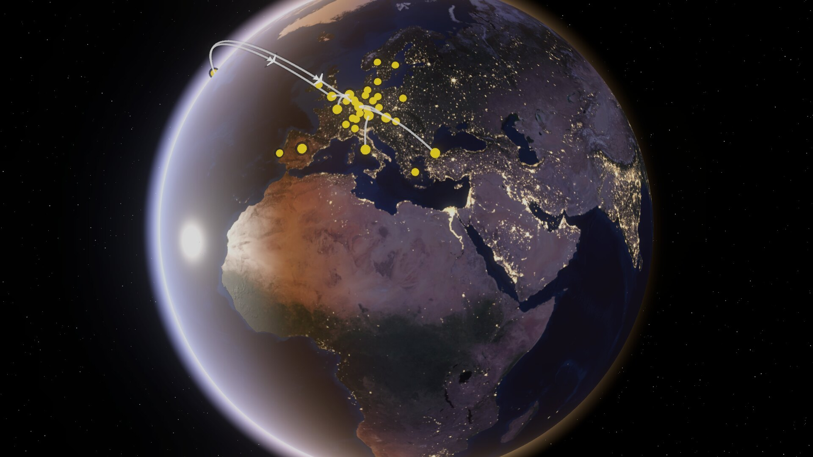
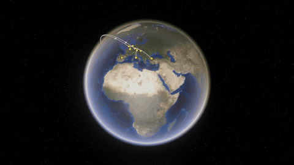
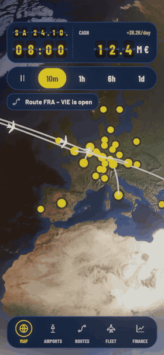
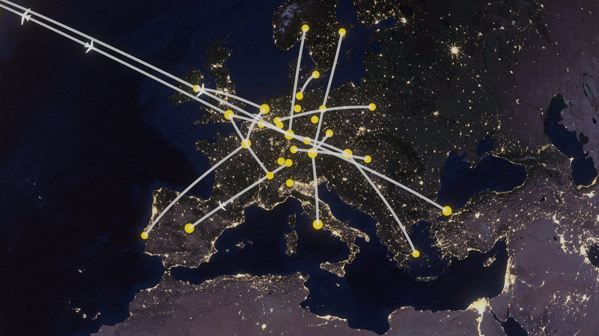
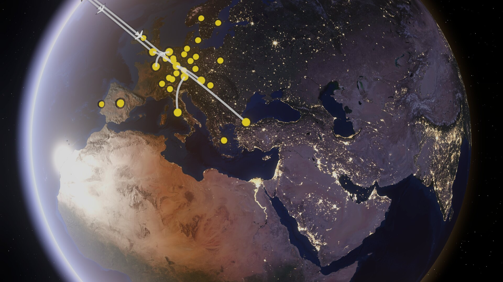
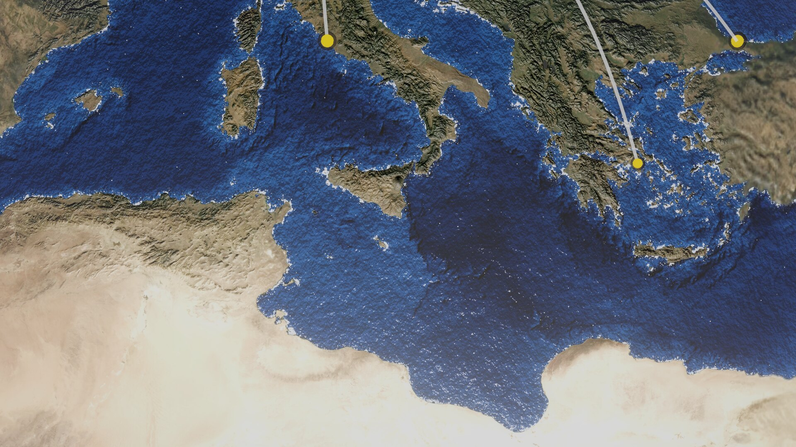
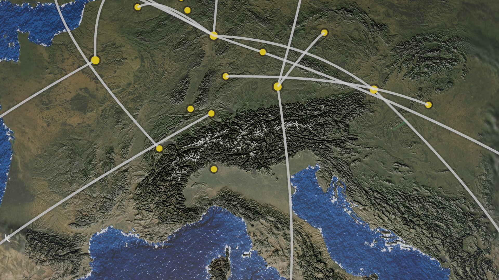
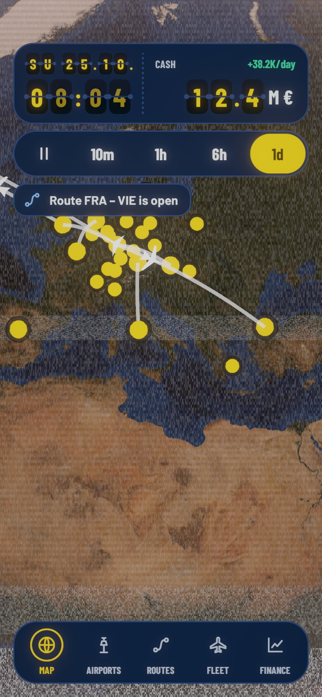

# unity_demo_globe

**A photorealistic Earth for an airport tycoon game, built in Unity 6.**
Day and night with real twilight, twinkling city lights, sun glint on animated water, relief you can fly over,
a zoom that streams sharper map tiles as you go in, and a flip-board HUD that runs the game clock.
All of it in custom URP shaders, driven by a clean view/controller split, ready for phones.

<p align="center">
  
</p>

> Europe at dusk: the terminator, golden atmosphere, sun flare, city lights on the night side and the airline routes of the demo.
> Everything on this page is rendered by the project itself.

## Watch it

<table>
<tr>
<td width="62%" valign="top">
<br>
<sub>From orbit into the Alps: five zoom stages, relief and tile detail fade in. <a href="docs/media/zoom-in.mp4">MP4 (sharper)</a></sub>
</td>
<td width="38%" valign="top">
<br>
<sub>The HUD: flip-card clock and cash, a slider for the game speed, an airport sheet. At one day per second the picture winds on like a video recorder. <a href="docs/media/hud-timelapse.mp4">MP4 (sharper)</a></sub>
</td>
</tr>
</table>

## What you get

<table>
<tr>
<td width="50%"><br>
<b>A night side that glitters.</b> City lights are generated per map cell in the shader, twinkle at a fixed pace and go out one by one after local midnight.</td>
<td width="50%"><br>
<b>Real sun, real twilight.</b> Sun and moon follow astronomical formulas; the terminator, golden rim and lens flare change with the game time.</td>
</tr>
<tr>
<td width="50%"><br>
<b>Living water.</b> Waves, surf along every coast and sun reflection on water and land. The relief lights up as the sun moves.</td>
<td width="50%"><br>
<b>Zoom all the way in.</b> Sharper map tiles stream in around the camera: day colour, relief, night lights and coast distance.</td>
</tr>
<tr>
<td width="50%"> <br>
<b>A HUD like an airport.</b> Departure-board flip cards for date, time and cash, a speed slider, a route strip with a little plane, a gate bar.</td>
<td width="50%"><br>
<b>Time that you can feel.</b> At one game day per second the picture shakes, rolls and crackles like a rewinding tape. The HUD stays steady on top.</td>
</tr>
</table>

## Highlights

**For players and artists**
- Earth from space down to a city, with day/night, dawn glow, atmosphere, moon, stars and a golden sun flare.
- Animated water, coastal surf, sun glints, relief shading and snow, city lights that flicker and switch off after midnight.
- Airports, flight routes as arcs above the surface and planes that fly their timetable. At high speed single planes turn into a flowing traffic stream.
- Game speeds from pause to one day per second. The speed control is a slider knob that glides to the chosen step.
- A flip-card HUD (Barlow font, navy and signal yellow) that looks the part in a game about airports.

**For developers**
- A reusable **view**: the game talks to it through two small interfaces (`IGlobeModel`, `IGlobeView`) and never touches rendering.
- **One JSON file** (`globe-config.json`) configures camera limits, what each zoom stage shows, device quality tiers and the tile pyramid. The view and the build script read the same file.
- A **tile pyramid** (day, night, relief, coast) is built by `tools/build_tiles.py` and streamed around the camera with a fallback to coarser tiles. Nothing big lives in the repository.
- Flights are a **timetable**, not positions: pause, speed changes and time jumps need no special handling.
- Device tiers (Low, Medium, High) cap zoom stage, features and texture memory; shader variants are warmed up before they are switched on, so there is no hitch.
- 44 EditMode tests, a headless screenshot and movie tool, assembly definitions that enforce the layering.
- Everything is plain C# and HLSL, no third-party packages beyond Unity's own (URP, Input System, uGUI).

## Quickstart

You need **Unity 6000.6.7f1** (Unity Hub, with the macOS/Windows/Linux editor module). The project is developed on macOS; the editor demo does not use platform-specific code.

```bash
git clone https://github.com/Smengerl/unity_demo_globe.git
```

1. In Unity Hub choose **Add → Add project from disk** and select the folder. Open it with 6000.6.7f1; the first import takes a few minutes.
2. Open the scene `Assets/Demo/Scenes/GlobeDemo` (if it is missing: menu **Tycoon → Create Demo Scene**).
3. Press **Play**. Drag to turn the globe, scroll to zoom, click an airport.

That is all: the base textures (8k day and night, relief, water) and the fonts are part of the repository.
The demo is meant for a phone-shaped window, so in the Game view pick an aspect like 9:19.5; in a wide window the HUD stays a centred phone-width column.

### Optional: sharp detail tiles

Without tiles the globe uses the base textures (about 5 km per pixel), which looks fine from orbit down to the continent. For sharp relief, coasts and city lights when you zoom in, build the tile pyramid once:

```bash
pip3 install numpy pillow            # Python 3
tools/get_data.sh                    # downloads the raw data into temp-src (about 200 MB, NASA and AWS)
python3 tools/build_tiles.py --estimate   # what would be made, and how big
python3 tools/build_tiles.py              # makes EarthTiles/ (about 140 MB, not committed)
```

Restart Play mode; the tiles stream in when you zoom in. With the raw data that `get_data.sh` fetches, day and night tiles reach 0.6 km per pixel over the quarter of the Earth from 0° to 90°E and 0° to 90°N (Europe, the Middle East, India), the relief tiles cover Central Europe, and the rest of the world has tiles of about 2.4 km per pixel. More raw data gives more tiles (see [tools/README.md](tools/README.md)).

## How to use the demo

| Action | Mouse | Touch |
|---|---|---|
| Turn the globe | drag | drag, with inertia |
| Zoom | scroll wheel | pinch |
| Select an airport | click a yellow marker | tap a marker |
| Deselect | click empty globe or the **X** of the airport sheet | tap empty globe or **X** |
| Frame a route | click the route strip (`FRA ✈ JFK`) in the airport sheet | tap it |
| Developer panel | **F1** | not available |

**The HUD from top to bottom**
- **Top pill:** the game date (`SU 25.10.`) and time as flip cards, with the cash (`12.4 M €`) and its change per day on the right.
- **Speed pill:** Pause, `10m`, `1h`, `6h`, `1d` mean game minutes, hours or days per real second. The yellow knob glides to your choice.
  `6h` and `1d` show traffic flow; `1d` calms the lighting and adds the fast-forward look.
- **Notices:** short messages, for example when a flight is delayed (the demo delays one every 15 seconds).
- **Airport sheet:** code, name, kind, the main route with distance and flight time, routes, flights per day, load, and two buttons (placeholders until a game exists).
- **Gate bar:** MAP, AIRPORTS, ROUTES, FLEET, FINANCE. Only the highlight moves in the demo.

**Try this**
1. Press `1h` and watch the terminator sweep over Europe, then `6h`, then `1d`.
2. Zoom into the Alps and the Mediterranean (needs the tiles) and compare day and night with `10m`.
3. Open the developer panel with **F1**: switch the quality tier (Low, Medium, High), start the stress test (200 airports and 800 routes) or lock the input.

## Configuration

Everything lives in [`Assets/GlobeView/Resources/globe-config.json`](Assets/GlobeView/Resources/globe-config.json); fields you leave out keep their defaults, enums are written as names.

| Section | What it controls |
|---|---|
| camera | start position, zoom limits (`MinHeight`, `MaxHeight`), field of view, drag and tap feel |
| `StageEdges`, `Stages` | camera heights where the five zoom stages change; per stage: relief, waves, surf, light grids, tile level, lens flare |
| `Tiers` | Low, Medium, High: highest stage, allowed features, size of the tile window in memory |
| `Tiles` | tile size, layers and level ranges, tile location (folder or http address) |
| sky, motion | fixed or astronomical sun, speeds for traffic flow, calm lighting and the fast-forward look, reduced motion |

## Use the view in your own game

The view reads a model and sends events. The demo shows the whole wiring in [`DemoMain.cs`](Assets/Demo/DemoMain.cs):

```csharp
var model = new MyController();                       // implements IGlobeModel (airports, routes, flight timetable, time, selection)
var host = GlobeViewHost.Create(GlobeViewConfig.LoadDefault(), model, Camera.main);
host.AirportTapped += model.SelectAirport;            // the view reports taps, the game decides what they mean

var hud = new GateChartHud(host, model, model, () => host.ZoomStage);   // model also implements IHudModel (cash, speed)
// every frame: model.Update(dt); hud.Tick(Time.unscaledDeltaTime);
```

Flights are given as `FlightView(DepartUtc, ArriveUtc, …)`; the view computes where a plane is for any game time.
The `FakeController` of the demo is a complete example with 32 airports, 20 routes, a timetable, delays and a stress mode.

## Project layout

| Folder | Content |
|---|---|
| `Assets/GlobeView/Contracts` | model types, `IGlobeModel`, `IGlobeView`, `GlobeViewConfig` (the only thing a game has to know) |
| `Assets/GlobeView/Runtime` | the view: host, camera, layers for airports, routes and planes, sky, detail control, tile window, lens flare, fast-forward look |
| `Assets/GlobeView/Resources` | shaders, base textures, `globe-config.json` |
| `Assets/Hud` | the "Gate Chart" HUD: flip cards, pills, airport sheet, gate bar, design tokens |
| `Assets/Demo` | `FakeController`, the demo scene, developer panel, screenshot and movie tool |
| `Assets/Tests/EditMode` | 44 tests |
| `tools/` | Python scripts that make the textures and the tile pyramid from raw data |
| `docs/` | documentation, HUD design tokens, screenshots and videos |

```
Contracts  ◄──  GlobeView (view)  ◄──  Demo (FakeController, scene)
    ▲                                       │
    └─────────────  Hud (UI)  ◄─────────────┘        Tests ──► everything
```

## Tools

- **Textures and tiles:** [tools/README.md](tools/README.md) (`get_data.sh`, `prep_textures.py`, `make_normals.py`, `make_coast.py`, `make_waves.py`, `build_tiles.py`).
- **Screenshots and movies without opening the editor** (close the project first; use a copy of the project if the editor is open):

```bash
Unity -batchmode -projectPath . -executeMethod Tycoon.Demo.EditorTools.Capture.Run \
  -tycoonShot shot.png -utc 2026-10-24T17:20:00 -lat 28 -lon 22 -height 2.6 -w 1920 -h 1080          # a still
Unity -batchmode -projectPath . -executeMethod Tycoon.Demo.EditorTools.Capture.Run \
  -movie zoom -frames 90 -fps 15 -outdir frames -w 1280 -h 720                                       # frames for a movie (zoom or hud)
ffmpeg -framerate 15 -i frames/frame_%04d.jpg -c:v libx264 -pix_fmt yuv420p zoom.mp4                # assemble
```

  More options (`-rate`, `-tier`, `-hud`, `-select`, `-stress`) are listed in [`Capture.cs`](Assets/Demo/Editor/Capture.cs).

## Tests

In Unity: **Window → General → Test Runner → EditMode → Run All**, or from the command line (the editor must not have the project open):

```bash
Unity -batchmode -nographics -projectPath . -runTests -testPlatform EditMode -testResults results.xml
```

The tests cover geometry and astronomy, zoom stages, the configuration file, the tile window, the controller contract, the view interface, the HUD (texts, flip cards, speed slider, sheet) and the fast-forward look.

## Documentation

- [docs/SOLUTION.md](docs/SOLUTION.md) – how everything works: architecture, coordinate conventions, astronomy, shader maths, data pipeline, tile system, quality tiers, lessons learned, constants.
- [docs/hud-design/HUD-DESIGN.md](docs/hud-design/HUD-DESIGN.md) – the HUD concept, components, rules and [design tokens](docs/hud-design/hud-tokens.json); fonts and their license in [FONTS.md](docs/hud-design/FONTS.md).
- [docs/MIGRATION-PLAN.md](docs/MIGRATION-PLAN.md) – how the prototype became a reusable view, what is done and what is next.

## Status

Runs on the desktop (developed and tested on macOS with Unity 6000.6.7f1). Not yet done: Android and iOS builds with measurements on real devices, the game logic (economy, airport and route management), screens behind the gate bar, tiles inside player builds (copy `EarthTiles` to `StreamingAssets/earth-tiles` or set `Tiles.BaseUrl`), a licenses page in the app.

## Credits and licenses

- Earth imagery: NASA Blue Marble Next Generation (topography and bathymetry, July 2004) and NASA Black Marble 2016 (Earth Observatory). NASA material is generally public domain; check the NASA media usage guidelines before you publish.
- Terrain: Terrain Tiles from the AWS Open Data registry (Terrarium encoding).
- Font: Barlow and Barlow Condensed by The Barlow Project Authors, SIL Open Font License 1.1 (texts next to the font files, notes in [FONTS.md](docs/hud-design/FONTS.md)).
- Built with Unity 6, the Universal Render Pipeline, the Input System and uGUI.
- Using this repository for a (paid) game needs a Unity plan that fits the publisher's own revenue (Unity Personal below USD 200K); details in [docs/LICENSES.md](docs/LICENSES.md), section 6. Full review of all third-party material, credit lines and a licence proposal: [docs/LICENSES.md](docs/LICENSES.md). The code of this repository has no license file yet; until one is added, all rights are reserved.
