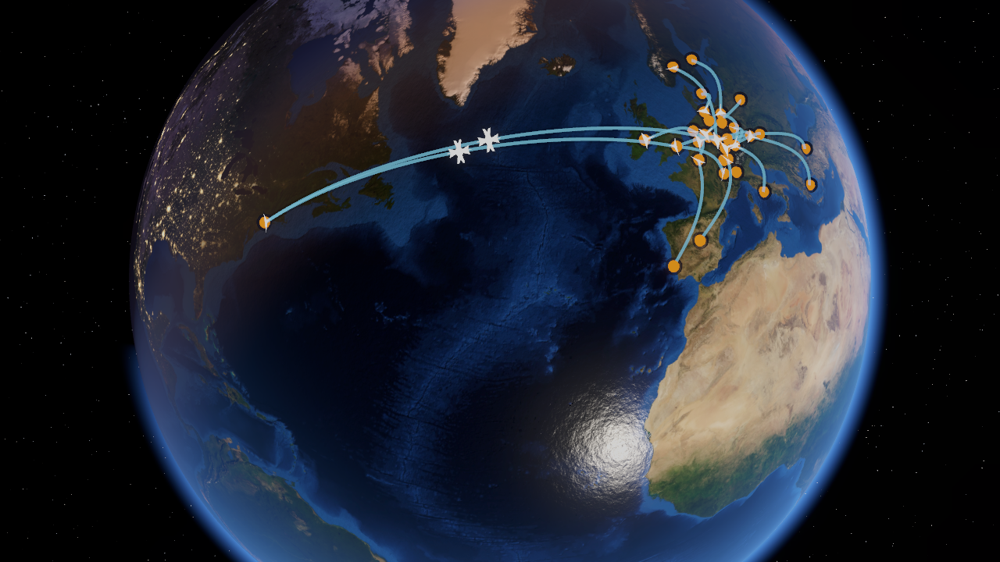

# Flughafen-Tycoon – Globus-Prototyp: Lösungsdokumentation

Stand: 2026-10-25, **nach der Migration in die View-Architektur** (Abschnitt 4; Plan: `MIGRATIONSPLAN.md`). Zweck dieses Dokuments: Den Globus später im Kontext des echten Handyspiels **reproduzieren oder übernehmen** zu können, ohne diese Session zu kennen. Alles Wichtige steht hier: Ziel, Entscheidungen, Architektur, Formeln, Datenpipeline, Stolpersteine, Übertragungs-Checkliste.

Die Datei `README.md` im Projektstamm ist die Kurzfassung, `tools/README.md` beschreibt die Datenpipeline, `docs/archiv/clouds-prototype.hlsl.txt` enthält die verworfenen prozeduralen Wolken.

> **Hinweis zu Namen:** Einige Abschnitte erklären Algorithmen, die aus dem Prototyp stammen. Die Klassen heißen jetzt anders; die Zuordnung steht in Abschnitt 4.

---

## 1. Ziel und Ergebnis

Spielidee: Flughafen-Tycoon fürs Handy. Der Spieler verwaltet Flughäfen, kauft Fluglinien dazwischen, lässt Flugzeuge darauf verkehren; die Spielzeit ist schneller und langsamer stellbar. Im Zentrum des Bildschirms steht immer eine 3D-Weltkugel (wischen = drehen, pinchen = zoomen). Sie soll möglichst gut aussehen.

Anforderungen, die die Lösung erfüllt:

| Anforderung | Umsetzung |
|---|---|
| Globus immer zentriert, Wischen dreht, Pinch/Scroll zoomt | Orbit-Kamera um den Ursprung (`GlobeCamera`) |
| Zoom bis ins Detail, dort Flughäfen wählbar | `MinHeight = 0.12` Erdradien über der Oberfläche; Detail aus der Kachel-Pyramide (Abschnitt 7b); Marker mit Tap-Auswahl über Bildschirmabstand |
| Weltraum, Mond und Sonne mit realistischen Bahnen | `Astronomy.cs` (Meeus-Näherung), `SkyRenderer`, Sternen-Skybox |
| Tag/Nacht realistisch, Städte leuchten nachts | Erd-Shader: Terminator mit Dämmerung, Black-Marble-Textur |
| Wasser realistisch, mit Struktur, spiegelt die Sonne | Wellen-Normal-Map, Facettenschattierung, Sonnenglanz |
| Land zeigt Sonnenstand | Relief aus SRTM-Höhendaten als Normal-Map |
| Flughäfen markiert, Flugzeuge bewegen sich auf Verbindungen | `AirportLayer`, `RouteLayer`, `FlightLayer` (Großkreis-Bögen mit Höhe) |
| Läuft später auf normalen Android-Handys | Qualitätsstufen Low/Medium/High (`DetailController`); Mobile-Einstellungen folgen mit der Portierung |

Referenzbilder: `docs/img/` (Nacht mit Stadtlichtern, Sonnenglanz auf dem Atlantik, Flugbögen, Europa in High und Low).



---

## 2. Technologieentscheidung

**Unity 6 (URP)**, nicht Unreal oder Godot. Begründung: Das Spiel besteht überwiegend aus Oberfläche und Simulationslogik, grafisch braucht nur der Globus Aufwand. Unreal ist dafür zu schwer (App-Größe um 100 MB leer, Lumen/Nanite auf Mobile nicht nutzbar, UMG für Verwaltungs-UI mühsam, schwache Geräte fallen raus). Unity hat das reifste Mobile-Ökosystem (IAP, Ads, Cloud Save), gutes UI-System und kleine Builds. Godot wäre die schlanke Alternative, hat aber dünnere Mobile-SDKs.

Alles Visuelle des Globus sind **Custom-Shader auf einer Kugel**, keine Engine-Spezialfunktionen. Das ist engine-unabhängig und portierbar.

---

## 3. Projekt-Setup (reproduzierbar)

- Unity Hub (per `brew install --cask unity-hub`), Editor **6000.6.7f1**, Vorlage **URP Blank** (liegt im Editor unter `Contents/Resources/PackageManager/ProjectTemplates/com.unity.template.urp-blank-17.2.6.tgz`).
- Das Projekt wurde ohne Hub-Dialog erzeugt: Template-Archiv entpackt, `package/ProjectData~/{Assets,Packages,ProjectSettings}` ins Projektverzeichnis kopiert, im Hub per *Add project from disk* eingebunden.
- Pakete (`Packages/manifest.json`): `com.unity.render-pipelines.universal 17.6.0`, `com.unity.inputsystem`, `com.unity.ugui` (Demo-Oberfläche), `com.unity.test-framework`, IDE-Pakete. Nicht benötigte Template-Pakete (Navigation, Analytics, Purchasing, Timeline, XR, 2D, Multiplayer-Center, Collab) sind entfernt. **Active Input Handling = Input System (neu)**; `UnityEngine.Input` (alt) ist nicht benutzbar.
- Aufbau (Details in Abschnitt 4): `Assets/GlobeView` (die View, mit eigenen Assemblies), `Assets/Demo` (Fake-Controller, Overlay-UI, Demo-Szene), `Assets/Tests/EditMode`, `tools/` (Datenpipeline), `docs/`.
- **Demo starten:** Szene `Assets/Demo/Scenes/GlobeDemo` öffnen und Play drücken (fehlt die Szene: Menü *Tycoon → Create Demo Scene*).
- **Wichtig:** Shader und Texturen liegen unter `Assets/GlobeView/Resources/`, damit sie in Player-Builds enthalten sind (Laden per `Resources.Load`, nicht `Shader.Find`).
- Tests: *Window → General → Test Runner → EditMode*; oder im Batchmodus `Unity -batchmode -nographics -projectPath . -runTests -testPlatform EditMode -testResults out.xml` (der Editor darf das Projekt nicht offen haben).

---

## 4. Architektur

Die Globus-Darstellung ist eine **View**: Sie zeigt, was der Controller des Spiels über `IGlobeModel` liefert, meldet Eingaben über Ereignisse und nimmt Befehle über `IGlobeView` entgegen. Spiellogik und Datenmodell liegen später getrennt (C#-Assembly `Tycoon.Domain`, noch nicht angelegt).

```
Assembly                         Inhalt                                          kennt
Tycoon.GlobeView.Contracts       Modelltypen, IGlobeModel, IGlobeView, Config   nichts (nur Unity-Typen)
Tycoon.GlobeView                 Rendering, Kamera, Ebenen, Detailstufen         Contracts, URP, Input System
Tycoon.GlobeView.Editor          Texturimport                                    GlobeView
Tycoon.Hud                       HUD „Gate Chart“ (uGUI in Code), IHudModel      Contracts, uGUI, Input System
Tycoon.Demo                      FakeController, DemoMain, DemoDevPanel          Contracts, GlobeView, Hud
Tycoon.Demo.Editor               Capture (Screenshots), DemoSceneBuilder, Guard  Demo, GlobeView
Tycoon.Tests.EditMode            22 Tests                                         alles
(später) Tycoon.Domain / App / UI  Spiellogik, Controller, HUD                    siehe Migrationsplan
```

Die View kennt weder Spiel noch Demo; das erzwingen die Assembly-Grenzen. Der **Fake-Controller** der Demo implementiert `IGlobeModel` genau so, wie es später der echte `GameController` tut.

### Ablauf

```
GlobeViewHost.Create(config, model, camera)         // ein GameObject, kein Singleton, keine Statics
  Initialize: Himmel, Erde, Atmosphäre, Sonne/Mond, Ebenen, Kamera, Lens Flare, Detailsteuerung
  LateUpdate -> TickCore(dt):
    GlobeData.Refresh(model)        kopiert Listen nur bei geänderter Version, leitet Richtungen/Bögen/Routenindex ab
    GlobeCamera.Tick                Eingabe, Kamerafahrt, Pose
    DetailController.Tick           Zoomstufe, Keywords, Kachelfenster (TileWindow)
    SkyRenderer.Tick                Sonne/Mond/Sterne aus der Spielzeit, Funkeluhr, Calm-Faktor
    AirportLayer / RouteLayer / FlightLayer.Tick
    SunFlare.Tick
    Ereignisse (CameraChanged, ZoomStageChanged, Ready)
```

### Dateien

| Datei (`Assets/GlobeView/...`) | Aufgabe |
|---|---|
| `Contracts/ModelTypes.cs` | `GameTimeState`, `AirportView`, `RouteView`, `FlightView` (Fahrplan), `SelectionState`, `CameraState` |
| `Contracts/IGlobeModel.cs` | was der Controller liefert: Zeit, Flughäfen, Routen, Flüge (je mit Versionszähler), Auswahl |
| `Contracts/IGlobeView.cs` | Ereignisse, Befehle, Abfragen der View; `QualityTier` |
| `Contracts/GlobeViewConfig.cs` | Startkonfiguration (ScriptableObject): Kamera, Zoomstufen, Qualität, Himmel, Bewegung |
| `Runtime/GlobeViewHost.cs` | Einstieg: Aufbau, Tick, Befehle, Tap-Behandlung, Aufräumen |
| `Runtime/GlobeData.cs` | die Kopie der Modelldaten und Ableitungen |
| `Runtime/GlobeCamera.cs` | Orbit-Kamera, Eingabe, Kamerafahrt, `FrameDirections`, Viewport-Versatz |
| `Runtime/AirportLayer.cs`, `RouteLayer.cs`, `FlightLayer.cs` | Marker, Linien, Flugzeuge (gepoolt) |
| `Runtime/SkyRenderer.cs`, `Astronomy.cs` | Sonne/Mond/Sterne, Funkeluhr, Calm-Faktor |
| `Runtime/DetailController.cs`, `TileWindow.cs`, `TileSource.cs`, `TileMath.cs` | Gerätestufe, Zoomstufen (aus der Config), Keywords; Kachel-Streaming |
| `Runtime/SunFlare.cs` | Lens Flare der Sonne |
| `Runtime/GeoMath.cs`, `RouteMath.cs`, `ZoomStages.cs`, `MeshFactory.cs` | reine Hilfsfunktionen (öffentlich testbar bzw. intern) |
| `Resources/Shaders/*.shader`, `TycoonCommon.hlsl` | Earth, Atmosphere, Stars, Body, Flat, Flare, gemeinsame Funktionen/Globals |
| `Resources/Earth/*`, `Resources/globe-config.json` | globale Basistexturen; die gemeinsame Konfiguration von View und Skript |
| `Editor/EarthTextureImporter.cs` | Importeinstellungen für `Resources/Earth` |
| `Demo/FakeController.cs` | Spielzeit, Flughäfen, Routen, Fahrplan, Verspätungen, Auswahl, Stresstest |
| `Demo/DemoMain.cs`, `DemoDevPanel.cs` | Demo-Einstieg und Entwickler-Werkzeuge (F1: Qualität, Stresstest, Kamera-Info) |
| `Hud/GateChartHud.cs` u. a. | das HUD (Zeit, Kasse, Tempo, Auswahl, Beschriftungen), siehe `docs/hud-design/HUD-DESIGN.md` |
| `Demo/Editor/Capture.cs` | Screenshots ohne Play-Modus (Abschnitt 13) |
| `Demo/Editor/DemoSceneBuilder.cs`, `PlayModeGuard.cs` | Demo-Szene erzeugen; Play beenden, wenn während Play neu kompiliert wird |

### Zuordnung der Prototyp-Namen (für ältere Textstellen)

| Prototyp | jetzt |
|---|---|
| `GlobeBootstrap` | `GlobeViewHost.Initialize` |
| `SimClock` | `GameTimeState` aus dem Modell; die Funkeluhr steckt im `SkyRenderer` |
| `SkyDriver` | `SkyRenderer` |
| `AirportData`, feste Routenliste | `Demo/FakeController` (Daten) und `AirportView`/`RouteView` (Verträge) |
| `GlobeCameraController` | `GlobeCamera` |
| `GlobeQuality`, `GlobeLod` | `DetailController` (Gerätestufe und Zoomstufen in einer Klasse, Instanzwerte statt Statics) |
| `GlobeHud` (IMGUI) | `Hud/GateChartHud` (uGUI) |
| `Capture` (Skript im Projekt) | `Demo/Editor/Capture.cs` |

### Grundprinzip der Szene
Die Erde dreht sich nie. Sie steht fest im Ursprung. Die *Kamera* kreist um sie, und die *Sonne* (Richtung) wandert mit der Spielzeit. Dadurch bleiben alle Positionen (Flughäfen, Routen) statisch, und Tag/Nacht ist nur ein Shader-Parameter.

**Shader-Globals** (Erd-fester Rahmen): `_TycoonSunDir`, `_TycoonMoonDir`, `_TycoonStarRot`, `_TycoonTime` (Funkeluhr, konstante Echtzeit-Geschwindigkeit), `_TycoonCalm` (0–1, siehe 12b). Gesetzt von `SkyRenderer` pro Frame und im Konstruktor vorbelegt, damit der erste Frame keinen Nullvektor sieht. Sie sind global: **ein aktiver Host zur Zeit.**

### Der Vertrag im Überblick
- **Modell → View** (`IGlobeModel`): `Time` (`UtcSeconds` als Unix-Sekunden, `Rate` = Spielsekunden pro Echtsekunde), `Airports`, `Routes`, `Flights`, `Selection`. Die Listen werden nur neu gelesen, wenn sich ihr Versionszähler ändert.
- **Flüge sind ein Fahrplan** (`DepartUtc`, `ArriveUtc`, Richtung, Klasse, Farbe): Die View berechnet die Position aus der Spielzeit. Pause, Tempowechsel, Zeitsprung und Laden eines Spielstands brauchen keine Sonderbehandlung; Verspätung = geänderte Zeiten, `FlightsVersion` erhöhen.
- **View → Spiel** (`IGlobeView`-Ereignisse): `AirportTapped(id)`, `EmptyTapped(lat, lon)`, `CameraChanged`, `ZoomStageChanged`, `Ready`.
- **Spiel → View** (Befehle): `FocusOn`, `FocusAirport`, `FrameRoute`, `SetZoomLimits`, `SetInputEnabled`, `SetViewportInsets` (Panels), `SetQualityTier`, `SetActive`, `SetPointerBlocker` (UI-Vorrang), `Get/SetCameraState`.
- **Abfrage:** `TryGetAirportScreenPoint(id)` liefert Bildschirmposition und Sichtbarkeit; die Spiel-UI zeichnet Beschriftungen selbst an diesen Ankern (Demo: `GateChartHud`).
- Nicht umgesetzt, weil noch nicht gebraucht: Antippen von Routen und Flugzeugen, freie Flugposen, GPU-Instancing, Beschriftungen durch die View.

---

## 5. Koordinaten- und Zeitkonventionen

**Erd-fester Rahmen** (`GeoMath.Dir`): Einheitskugel im Ursprung, +Y = Nordpol, Länge 0/Breite 0 liegt bei **−Z**, Osten = **+X**. Von außen gesehen (Kamera bei −Z, blickt nach +Z) ist Osten rechts.

```
Dir(lat, lon) = ( cos(lat)·sin(lon),  sin(lat),  −cos(lat)·cos(lon) )
```

Dieselbe Abbildung benutzen Shader und C#. `MeshFactory.Sphere` erzeugt Vertices in genau dieser Anordnung und setzt UVs:

- `u = k/segments + 0.5` (läuft über 1 hinaus, bleibt kontinuierlich, Texturen wrappen), `v = 1 − r/rings`.
- Der Erd-Shader liest Länge/Breite **aus der Mesh-UV** (`frac(u)*360−180`, `(v−0.5)*180`). Vorher wurde `atan2/asin` pro Pixel gerechnet; das war teurer und erzwang eine Sonderbehandlung der Datumsgrenze für Mip-Ableitungen.

**Texturen** sind equirektangular (u = Länge von −180° nach 180°, v = Breite von −90° nach 90°, Nord oben).

**Lokale Himmelsrichtungen** am Punkt N (für Relief und Wellen): `E = normalize(−N.z, 0, N.x)` (Ost), `Nn = cross(E, N)` (Nord). In Polnähe wird `length` geklemmt.

**Zeit:** gehört dem Controller (`GameTimeState`: `UtcSeconds`, `Rate`). Der Fake-Controller startet mit der echten UTC-Zeit, damit der Terminator der Wirklichkeit entspricht, und bekommt die Stufen vom HUD (Pause, 10 min/s, 1 h/s, 6 h/s, 1 Tag/s, siehe `docs/hud-design`); er läuft mit `Time.unscaledDeltaTime`, also unabhängig von `Time.timeScale`. Die View besitzt keine eigene Spielzeit, nur eine Echtzeituhr fürs Funkeln.

---

## 6. Astronomie (`Astronomy.cs`)

Niedrigpräzise Näherung (Sonne ~0,3°, Mond ~1°, nach Meeus), reicht für Optik, nicht für Navigation.

1. Tage seit J2000: `d = UnixSekunden/86400 − 10957,5` (2000-01-01 12:00 UTC = Unix-Sekunde 946728000).
2. Ekliptikschiefe `ε = 23.4393° − 3.563e−7·d`.
3. Greenwich-Sternzeit `GMST = 280.46061837 + 360.98564736629·d` (mod 360).
4. Sonne: mittlere Länge `L = 280.460 + 0.9856474·d`, Anomalie `g = 357.528 + 0.9856003·d`, ekliptikale Länge `λ = L + 1.915·sin g + 0.020·sin 2g`, Breite 0 → Rektaszension/Deklination über `EclipticToEquatorial`.
5. Mond: `Lm = 218.316 + 13.176396·d`, `M = 134.963 + 13.064993·d`, `F = 93.272 + 13.229350·d`, `λ = Lm + 6.289·sin M`, `β = 5.128·sin F`.
6. In den Erd-festen Rahmen: Richtung = `Dir(dec, ra − GMST)`. Der Subsolar-Punkt liegt also bei Breite = Deklination, Länge = RA − GMST.
7. Sterne sind im Weltraum fest: Skybox wird um `GMST` um die Y-Achse gedreht (`Matrix4x4.Rotate(Quaternion.AngleAxis(gmst, up))`, Shader-Global `_TycoonStarRot`).

Plausibilitätsprüfung (per Skript): Elongation am 2026-10-10 16:00 UTC ≈ 4° (Neumond), am 2026-10-26 04:00 UTC ≈ 175° (Vollmond ~04:12 UTC, 5° Abweichung). Sonnen-Deklination Ende Oktober ≈ −12°.

Skalierung der Szene (Erdradius = 1): Mond bei **60,3** mit Radius **0,2727** (maßstäblich), Sonne bei 150 mit Radius 0,7 (nicht maßstäblich, aber richtige Größe am Himmel). Kamera-Far-Plane 400.

---

## 7. Datenpipeline der Texturen

Details und Befehle: `tools/README.md`. Kurz:

| Textur | Quelle | Aufbereitung | Datei |
|---|---|---|---|
| Tag | NASA Blue Marble Next Generation (Juli 2004, Topo+Bathy), 21600×10800 | auf 8192×4096 verkleinert | `Resources/Earth/day.jpg` |
| Nacht | NASA Black Marble 2016 Farbe, 13500×6750 | auf 8192×4096 | `night.jpg` |
| Relief global | AWS Terrain Tiles (Terrarium) z=4, 256 Kacheln | Mercator → equirektangular 4096×2048, Neigung → Normal-Map | `normal.png` |
| Wellen | selbst erzeugt (FFT, 1/f^1.4, nahtlos) | 256×256 | `waves.png` |
| Tiefsee-Maske | AWS Terrain Tiles z=4 (Höhe unter −200 m) | 8192×4096, Wasser = weiß | `watermask.png` (ergänzt die Farb-Wassererkennung, siehe 8) |
| Küstenabstand | aus `day.jpg` (Wasserregel wie im Shader, plus Tiefsee-Maske) | Grauwert = Abstand vom Land über Wasser, 0–8 px (≈39 km) | `coast.png` 8192×4096 |

Terrarium-Höhe: `h = R·256 + G + B/256 − 32768` Meter. Ozean wird auf 0 geklemmt (flach). Normal-Map-Kodierung: `rgb = n·0.5+0.5`, **x = Ost, y = Nord, z = oben** (Tangentialraum des lokalen Rahmens, nicht der UV-Raum eines Meshes). Neigung 8-fach überhöht (`K = 8`), weil das echte Relief zu flach wirkt.

**Import-Einstellungen** (`EarthTextureImporter`, nur Pfad `/Resources/Earth/`): max. 8192, Mipmaps, trilinear, Aniso 8, `CompressedHQ`, **sRGB aus** für `watermask`, `normal`, `waves`; `detail*` mit Clamp, `waves` mit Repeat, sonst U Repeat / V Clamp. `GetVersion()` hochzählen, um Reimport zu erzwingen.

Speicher (grob): day+night je 8192×4096 und drei Normal-Maps (Basis, im Repo) – mit ASTC auf Android ca. 50 MB; dazu das Kachelfenster (Abschnitt 7b, je nach Gerätestufe 0 bis ca. 200 MB).

Wasser wird aus der Tagfarbe geschätzt (scharfe Küsten), die Tiefsee-Maske ergänzt Meeresrücken und Seeberge, die in den Blue-Marble-Farben blass wirken und sonst als Land gälten. Nicht vorhanden: Wolken. Detailabdeckung endet bei 0°E (London, Dublin, Madrid liegen außerhalb – dafür Kachel B1 ergänzen).

---

## 7b. Konfiguration und Kachel-Pyramide

**Eine Konfigurationsdatei** (`Assets/GlobeView/Resources/globe-config.json`) ersetzt die frühere ScriptableObject-Klasse. View und Skript lesen dieselbe Datei. Die Klasse `GlobeViewConfig` ist nur noch der Leser (`LoadDefault()`, `FromJson()`); fehlt ein Feld, gilt der Standardwert, Enums stehen als Namen (`"Tier": "High"`, `"Features": "Relief, Waves"`).

| Bereich | Inhalt |
|---|---|
| Kamera | Start, Zoomgrenzen (`MinHeight`/`MaxHeight`), Sichtfeld, Wischen, Tippen |
| `StageEdges`, `Stages[5]` | Höhen der Stufenwechsel; je Stufe: Name, `TileLevel` (-1 = nur Basis), Relief, Wellenschichten, Schaum, Lichtgitter, Nacht-/Tag-Detail, Flares |
| `Tiers[3]` | Low, Medium, High: `StageCap`, erlaubte `Features`, `WindowTiles` (Kacheln pro Seite im Fenster), `LevelOffset` |
| `Tiles` | `TileSize`, `BaseUrl`, `TilesPerFrame`, `CoastKm`, `Layers` (day, night, relief, coast mit Format und Stufenbereich) |
| Himmel, Bewegung | Sonne/Mond, Tempo-Grenzen für Verkehrsfluss, Beruhigung und Spul-Look |

**Pyramide:** Plattkarte, Stufe L hat 2^(L+1) × 2^L Kacheln zu `TileSize` Pixeln, Kachel (0, 0) liegt im Nordwesten, Dateien `EarthTiles/<Ebene>/<Stufe>/<x>_<y>.jpg|png`. Stufe 4 entspricht etwa 2,4 km pro Pixel, Stufe 5 1,2 km, Stufe 6 0,6 km. Die Kacheln liegen nicht im Repo (`.gitignore`).

**Skript:** `python3 tools/build_tiles.py` liest die Config, zählt vorab die Kacheln (`--estimate`) und macht nur die Kacheln, die die Rohdaten hergeben (Quelle fein genug und ganze Kachel abgedeckt); `--layers`, `--levels`, `--workers` schränken ein. Mit den vorhandenen Rohdaten entstehen etwa 141 MB: Tag und Nacht Stufe 4 weltweit, Stufe 5 und 6 im Viertel der Erde 0–90°O, 0–90°N; Relief nur über Mitteleuropa; Küstenkacheln nur an Küsten. Fehlende Kacheln sind erlaubt, die View nimmt dann die nächstgröbere.

**Laufzeit** (`TileWindow`): Aus der Stufe (`Stages[...].TileLevel` plus `LevelOffset` der Gerätestufe) und der Kameraposition ergibt sich ein Block aus `WindowTiles` × `WindowTiles` Kacheln um die Kamera. Er wird im Hintergrund zu **einer Textur je Ebene** zusammengesetzt, die der Erd-Shader im Rechteck des Blocks über die Basis legt. Fehlt eine Kachel, wird die nächstgröbere hineingedehnt; wo gar nichts existiert, bleibt das Pixel durchsichtig (Alpha 0). Ein neuer Block entsteht neben dem alten und ersetzt ihn erst, wenn er fertig ist (oder nach 8 s); er wird neu gebaut, wenn die Kamera aus der mittleren Hälfte des Blocks wandert oder die Stufe wechselt. Die Kacheln liest ein Hintergrund-Thread (Ordner) oder `UnityWebRequest` (Adresse, auch `jar:` auf Android), entschlüsselt wird auf dem Hauptthread (`TilesPerFrame`).

**Speicher:** je Ebene `WindowTiles × TileSize` Pixel im Quadrat (6 Kacheln = 3072 px, rund 50 MB mit Mip-Stufen, vier Ebenen auf High also etwa 200 MB, beim Wechsel kurz das Doppelte). Low lädt nichts, Medium nur die Nachtkarte mit 4 Kacheln.

**Noch offen:** Die Kacheln sind noch nicht Teil eines Player-Builds (Ordner nach `StreamingAssets/earth-tiles` kopieren oder `Tiles.BaseUrl` auf einen Server setzen); die Rohdaten für mehr Gebiete (weitere NASA-Kacheln, feinere Terrain-Stufen) müssen geladen werden; das Fenster zeigt immer nur ein Gebiet.

---

## 8. Erd-Shader (`Earth.shader`)

Ein Pass (URP, `LightMode = UniversalForward`), unlit, eigene Beleuchtung. Variablen: `N` Normale (= Richtung vom Mittelpunkt), `V` zur Kamera, `L` zur Sonne, `ndl = dot(N, L)`.

**Schritte pro Pixel**

1. **UV** aus Mesh, Ableitungen `ddx/ddy` für `SAMPLE_TEXTURE2D_GRAD` (nötig, weil mit manuellem UV und Verzweigungen gesampelt wird).
2. **Tagfarbe** `_DayTex`. Mit `TY_DETAIL`: das Kachelfenster `_DetailTex` im Rechteck `_DetailRect` (Länge/Breite in Grad), weich ausgeblendet am Rand (`smoothstep(0, 0.04, …)`) und **nach Alpha gewichtet** (Alpha 0 = hier gibt es keine Kachel, die Basis scheint durch); Ableitungen werden mit `360/span` bzw. `180/span` umgerechnet.
3. **Relief** (`TY_RELIEF`): Tangentialnormale `tn` aus `_NormalTex` (und `_DetailNormalTex` im Kachelfenster) → `Nterrain = normalize(E·tn.x + Nn·tn.y + N·tn.z)`; `ndlTerrain = lerp(ndl, dot(Nterrain, L), _Relief)`.
4. **Wasser:** `water = max(Farbschätzung, Tiefsee-Maske)`; Schätzung `smoothstep(1.08, 1.45, b/(max(r,g)+0.003))` (Verhältnis statt Differenz, damit sehr dunkle Tiefsee zählt; Eis/Weiß ≈ 1 zählt nicht), Maske `watermask.png` (Höhe < −200 m; −200 statt 0, damit Senken unter dem Meeresspiegel wie Death Valley nicht als Wasser gelten). Ohne die Maske erschienen Meeresrücken als graue „Inseln“ im Ozean.
5. **Tagseite:** `lit = smoothstep(−0.20, 1.1, ndlTerrain)` (weicher Abfall statt hartem Lambert), `col = day · (0.012 + lit·1.35) · warm`; `warm` färbt nahe dem Terminator orange.
6. **Dämmerung:** `dusk = smoothstep(−0.32, −0.02, ndl) · (1 − smoothstep(0.02, 0.30, ndl))` – Sonne zwischen +5° und −18°. Farbe von Orange am Terminator zu Blau weiter in der Nacht; `col += (day·0.6 + 0.04) · tint · dusk · 0.5`.
6b. **Nachtseite, Tag-Karte bleibt sichtbar:** In dunkler Nacht wird die Tagkarte samt Relief schwach in bläulichem Mondlicht dazugerechnet: `col += day · (0,55 0,72 1) · (0,04 + 0,09·moonLit) · _NightDay · nightMask`, `moonLit = smoothstep(−0,2, 1,1, dot(Nsurf, Mondrichtung))` (Shader-Global `_TycoonMoonDir`, `Nsurf` = Normale mit Relief). So bleiben Küsten, Gebirge (Alpen mit Schnee) und Land/Meer auch nachts lesbar, die pixelige Nachtkarte ist nur noch ein Anteil. `_NightDay` (0–3, Standard 0,7) regelt die Helligkeit.
7. **Stadtlichter:** `nightMask = 1 − smoothstep(−0.30, 0.10, ndl)` (ab Sonnenuntergang, voll bei nautischer Dämmerung), `col += night · (1, 0.78, 0.5) · _CityGain · nightMask`.
   - Die Nachtkarte wird mit **quintischer Texel-Interpolation** statt bilinear gelesen (`_NightTex_TexelSize`), damit vergrößerte Stadtlichter runder wirken. Im Kachelfenster (`TY_NIGHTDETAIL`) wird zusätzlich die scharfe Nachtkarte aus den Kacheln eingeblendet (`_UseDetailNight`, gleicher Rand und Alpha wie das Tag-Detail).
   - **Funkelnde Lichtpunkte** (`TY_LIGHTS`, Medium/High): Beim Zoomen wird die Nachtkarte zu einem **Feld einzelner, unabhängig funkelnder Lichter**, überall auf der Erde scharf (die Punkte entstehen im Shader). **Lichter pro Kartenpunkt:** Funktion `UvLights` legt ein Gitter quadratischer Zellen in den UV-Raum (Zeilen gleicher Höhe, Zellen pro Zeile ≈ `2·cellsV·cos(lat)`, damit die Zellen auch in hohen Breiten quadratisch bleiben). Jede Zelle hat höchstens einen Punkt (weicher, runder Schein, Radius 0,7–1,05 Zellen, `exp(−r²/size²·3)`); ob er leuchtet, entscheidet die Nachtkarte **an der Position der Zelle** (`NightLumAt`: Globalkarte, im Detailrechteck die scharfe 500-m-Karte): `p = saturate(smoothstep(0,06, 0,80, sqrt(Luminanz))·_LightDensity)` (Karte ist linear, `sqrt` hebt dunkle Vororte an), Zufallszahl pro Zelle (`TyHash`) gegen `p`. Helle Karten-Pixel ergeben also viele leuchtende Zellen, dunkle fast keine; die Karte wird als Lichterfeld nachgebaut, ihre Pixel sind nicht mehr sichtbar. **Drei Gitter** mit `cellsV` = 4096 (1 Kartenpixel pro Zelle, ≈ 4,9 km), 8192 (≈ 2,4 km) und 16384 (≈ 1,2 km); das feinste Gitter, dessen Zellen mindestens ca. 2–3 Pixel groß sind, übernimmt von den gröberen (`fade = saturate((px − 1,0)/1,2)`, `w4 = f4`, `w2 = f2·(1 − f4)`, `w1 = f1·(1 − f2)`). **Wichtig:** `px` wird aus `psPix = max(length(ddx(N)), length(ddy(N)))` berechnet, nicht aus `fwidth` – `length(fwidth(N))` überschätzt die Pixelgröße um das ca. 1,5-Fache und lässt die Gitter zu früh ausblenden. **Funkeln:** pro Punkt zwei Sinusanteile mit zufälliger Rate (1,5–6 rad/s) und Phase, Faktor ca. 0,08–1, dazu kurze helle Aufblitzer (`1,6·pow(max(0, sin(…)), 14)`); Uhr `_TycoonTime` (= Echtzeituhr des `SkyRenderer`, konstante Geschwindigkeit `TwinkleSpeed = 0.45`, unabhängig von Spielzeit, Pause und Kamera; `Capture -time` friert es ein). Jedes Pixel addiert den Schein der **3×3 Zellen** um sich (`CellLight`), damit die Lichter ineinander verwaschen statt wie ein regelmäßiges Punkteraster zu wirken; die Zellen in alle Richtungen zu berücksichtigen verhindert abgeschnittene (quadratische) Ränder. Helligkeit der Gitter 0,22 / 0,3 / 0,4 (fein / mittel / grob), mal `_CityGain·0,5·_Sparkle`; höher überbelichtet die überlappenden Scheine zu weißen Flächen. **Die Nachtkarte liegt nur noch mit `_NightMapAlpha` (Standard 0,12) darunter**, dort wo Punkte aktiv sind (`glowK = lerp(1, _NightMapAlpha, saturate(f4 + f2 + f1)·saturate(_Sparkle))`). Dichte steuert `_LightDensity` (0,5–8, Standard 3,5). Weit weg (Zellen < ca. 1,6 Pixel) bleibt das gewohnte Leuchten der Karte. Steuerung `_Sparkle` (0–2; 0 = Funkeln aus).
   - **Grenze:** Wo es Nachtkacheln gibt (Kachelfenster), ist die Nachtkarte scharf; sonst liegen die Lichter auf dem Raster der Globalkarte (4,9 km pro Pixel, auf Low/Medium 9,8 km) und werden durch die feinen Gitter als Punktefeld dargestellt. Wie weit scharfe Kacheln reichen, bestimmen die Rohdaten und `Tiles.Layers` in der Config (Abschnitt 7b).
   - **Ab Mitternacht gehen die Lichter nach und nach aus:** Ortszeit über den Stundenwinkel (`hourAngle` = Länge − Länge des Subsolarpunkts, auf [−π, π) normiert; positiv = Nachmittag/Abend, negativ = Morgen). Auf der Morgenseite wächst `morning = saturate((ndl − ndlMitternacht)/(0,2 − ndlMitternacht))` von 0 (Mitternacht) bis 1 (Ende der Morgendämmerung, Sonne ca. 11° über dem Horizont); `ndlMitternacht = L.y·N.y − √(1−L.y²)·√(1−N.y²)` ist die Sonnenhöhe um Mitternacht für diese Breite. Die Punkte nutzen `lightMask = 1 − morning` mit einem festen Schwellwert je Punkt (siehe unten), das Leuchten der Nachtkarte wird mit `(1 − morning)` gedimmt. Gemessen (Mitteleuropa, Zoom 0,3): Anteil heller Pixel Abend 3,9 %, 03:00 UTC 2,3 %, kurz vor Morgengrauen 1,0 %.
   - **Dämmerung:** Die Punkte brauchen länger als die Karte, bis sie ausgehen (`lightMask = 1 − smoothstep(−0,30, 0,20, ndl)`, Sonne bis ca. 11° über dem Horizont), und **jeder Punkt hat seine eigene harte Schwelle** (`on *= step(h2, lightMask)` mit Zufallszahl `h2` pro Zelle): Liegt `lightMask` darüber, leuchtet er voll, liegt es darunter, ist er ganz aus – kein gleichmäßiges Herunterdimmen. Je höher die Sonne steigt (bzw. nach Mitternacht), desto weniger Lichter sind an; sie gehen nacheinander aus, abends nacheinander an.
8. **Wellen** (`TY_WAVES`, nur Wasser): drei Schichten derselben `waves.png` mit **unverwandten Maßstäben und Winkeln** (Kachelzahlen 80/210/520 in Länge, Winkel 0°/37°/71°, Drift gegenläufig), plus große ruhige/raue Flecken aus einem sehr großen Durchlauf derselben Textur (`calmRough`). Normale wird gekippt: `Nw = normalize(E·g.x + Nn·g.y + N)`. Facetten: `facet = 1 + 5·(dot(Nw,L)−ndl) + 2·(dot(Nw,V)−dot(N,V))`, geklemmt 0,45–1,7, multipliziert auf die Wasserfarbe. Fade mit Abstand `saturate(1 − length(fwidth(N))·220)`; Mip-Mittelung glättet zusätzlich.
9. **Sonnenglanz auf Land und Schaum an der Küste:**
   - **Land-Reflexion:** `landSpec = pow(dot(Nsurf, H), 24) + 0,25·pow(dot(Nsurf, H), 6)` mit der Reliefnormalen, Faktor `(0,3 + 1,2·smoothstep(0,12, 0,55, Helligkeit der Tagfarbe))` (heller Boden wie Sand/Schnee spiegelt stärker als Wald), nur Tagseite, nicht unter Wolken. Breit und schwach, folgt dem Relief. Steuerung `_LandGlint` (0–2, Standard 0,6).
   - **Schaum und Brandung** (`TY_FOAM`, Medium/High, nur auf Wasser, braucht `coast.png`) – **als sich ständig veränderndes Kräuselmuster, das zur Küste hin stärker wird** (keine Linie entlang der Küste, keine regelmäßige Wanderung vom Land weg): Der Küstenabstand `coastKm` kommt aus den Küstenkarten (global/Detail). `wCoast = pow(1 − smoothstep(0, 26 km, coastKm), 1,4)`. Das Muster `ripple` besteht aus drei Rauschschichten, die in verschiedene Richtungen driften (wie die Wellen im Wasser): `n1` ≈ 15 km (`N·420`), `n2` ≈ 6 km (`N·1100`), `n3` ≈ 37 km (`N·170`, langsam: geschäftige und ruhige Küstenabschnitte); `n1`/`n2` blenden aus, wenn ihre Struktur kleiner als ein Pixel wird (`psPix`-basiert). Die Schwelle sinkt zur Küste hin (`thr = lerp(1,05, 0,55, wCoast)`), `foamField = smoothstep(thr, thr + 0,14, ripple)`: fern der Küste fast nichts, nahe der Küste viel Weiß. Dazu **weiße Pixel** (`FoamDots`, 3D-Zellraster in drei Größen 0,0003 / 0,0008 / 0,0020 rad ≈ 2 / 5 / 13 km, das feinste mit mindestens ca. 2–3 Pixel pro Zelle übernimmt); jede Zelle würfelt alle paar Sekunden neu (`phase = t·1,4 + Zufall`, Überblendung zwischen zwei Würfen), Dichte `wCoast·(0,25 + 0,9·foamField)`. Zeit `_TycoonTime` = **Echtzeit mit konstanter Geschwindigkeit**, unabhängig von der Spielzeit. Helligkeit `_Foam` (0–2, Standard 1), nachts gedimmt (Mondlicht). Küstenkarten erzeugt `tools/make_coast.py`; `_CoastKm = 39` und `_DetailCoastKm = 34` müssen zu den dort verwendeten Maximalabständen passen. (Verworfene Variante: zur Küste laufende Brandungslinien mit Schwell-/Uferlinie – wirkte wie ein weißer Umriss um die Kontinente.)
10. **Sonnenglanz:** `(pow(dot(Nw,H), 400) + 0.03·pow(dot(N,H), 60)) · 1.2` auf Wasser, nur Tagseite. Dazu Fresnel-Himmelsspiegelung `pow(1 − dot(N,V), 4)` und ein Atmosphärenrand `pow(1 − dot(N,V), 3)` auf der Sonnenseite.

**Keywords** (`multi_compile_local`, zur Laufzeit vom `DetailController` gesetzt; alle Varianten sind im Build enthalten): `TY_WAVES`, `TY_RELIEF`, `TY_DETAIL` (Tag-Detail), `TY_NIGHTDETAIL` (scharfe Nachtkarte), `TY_LIGHTS` (Lichtpunkte), `TY_FOAM` (Schaum an der Küste). Ohne Keywords = Low. Intern: `TY_REGION` wird definiert, wenn `TY_DETAIL` oder `TY_NIGHTDETAIL` aktiv ist (das Detailrechteck wird berechnet).

**Wichtige Parameter** (Material-Properties): `_Relief` 1, `_LandGlint` 0,6, `_Foam` 1, `_NightDay` 0,7, `_NightMapAlpha` 0,35, `_WaveStrength` 2,5, `_Shininess` 400, `_GlintStrength` 1,2, `_CityGain` 3, `_AtmoColor` (0,35 0,6 1), `_DetailRect`, `_UseWaterMask`.

---

## 9. Weitere Shader

- **Atmosphere** (`Atmosphere.shader`): Kugel mit Radius 1,05 um die Erde, `Cull Front` (nur Rückseiten), `Blend One One`, `ZWrite Off`. Pro Pixel: Abstand des Sehstrahls vom Erdmittelpunkt `b = |cross(rd, camPos)|`, Intensität `pow(saturate((1.05 − b)/0.05), 3)`, mit Tag-Faktor aus dem nächsten Punkt des Strahls. Das Mesh-Scale und `_RadiusOut` müssen gleich sein.
- **Stars** (`Stars.shader`): Skybox-Shader, zwei Schichten Hash-Sterne auf Zellen der rotierten Richtung (`_TycoonStarRot`), Farbtönung zufällig.
- **Body** (`Body.shader`): Sonne (`_Emissive = 1`, Helligkeit 4 für Bloom) und Mond (Lambert gegen `_TycoonSunDir`, daher richtige Phase).
- **Flat** (`Flat.shader`): Unlit mit `_Color × Vertexfarbe`, `Blend SrcAlpha OneMinusSrcAlpha`, `ZWrite Off`, `Cull Off`. Für Marker, Routenlinien, Flugzeuge.
- **Render-Queues:** Konturen 3000 → Marker/Linien 3001 → Flugzeuge 3002. Die dunklen Konturen (halbtransparent) liegen unter den Objekten, damit alles auf hellem Untergrund lesbar bleibt.
- Gemeinsam `TycoonCommon.hlsl`: bindet URP-`Core.hlsl` ein, deklariert die Globals, `TyHash`, `TyNoise`, `TyNoiseD` (Letzteres aktuell ungenutzt).


### Zusatzeffekte (Atmosphäre, Glare, Lens Flare)

- **Atmosphäre:** Halo-Kugel Radius 1,07, Intensität 1,9, **ein durchgehender Verlauf Gold → Blau** (`dayMix = smoothstep(−0,35, 1,0, Sonnenseite)·0,75`: am Terminator schwaches Gold (0,85 0,5 0,24), am Mittag noch ca. 25 % Gold, damit es nicht wie zwei getrennte Farbübergänge aussieht; Terminatorglühen schwach), dickerer Abfall (`pow(t, 2,4) + 0,35·pow(t, 6)`), Sonnenuntergangsfarben (Orange am Terminator, Blau am Tag), zusätzliches Glühen direkt am Terminator, **Vorwärtsstreuung** (`pow(saturate(dot(Blickstrahl, Sonne)), 5)`: im Gegenlicht leuchtet die Atmosphäre bis zu 4-fach heller). Der Rand auf der Erdoberfläche ist entsprechend dicker (weiter Innenschleier + heller Rand, gleiche Farben, Gegenlicht-Verstärkung).
- **Glare/Glow/Land:** Sonnenglanz auf Wasser jetzt in drei Maßstäben (schmal 400, breit 60, sehr breit 9); Land bekommt drei Reflexlappen (24 / 6 / 2,5) plus ein silbriges Streiflicht an flachen Blickwinkeln zur Sonne (`graze`), `_LandGlint` Standard 0,8 (mehr ließ Wüsten ausbleichen). Bloom auf High: Threshold 0,85, Intensität 1,0, Streuung 0,72.
- **Lens Flare** (`SunFlare.cs`, Shader `Flare.shader`): acht additive Sprites (goldene Palette, keine bunten Ghosts) als Kinder der Kamera (Tiefe 0,5, nach dem Near-Plane): warmes Halo, Kernglühen, horizontaler Streifen und fünf Ghosts entlang der Linie durch die Bildmitte (Positionen `Mitte + (Sonne − Mitte)·k`, k = 0,55 / −0,4 / −0,9 / −1,55 / 0,25), Ghosts und Streifen erst ab Medium und nur bis Z2 (siehe 12b). Die Erde verdeckt die Sonne (Abstand des Sehstrahls Kamera–Sonne zum Erdmittelpunkt, weich zwischen 0,98 und 1,07, damit die Sonne durch die Atmosphäre scheinen kann); Ausblenden zum Bildrand. Eine `MaterialPropertyBlock` darf nicht in einem Feld-Initialisierer erzeugt werden (Unity wirft eine Exception).

---

## 10. Kamera und Eingabe (`GlobeCamera`)

- Zustand: `Lat`, `Lon` (Position der Kamera über dem Globus), `Height` (Abstand zur Oberfläche in Erdradien, Standard 0,12–5, per `SetZoomLimits` änderbar). Pose: `pos = Dir(Lat, Lon) · (1 + Height)`, `rotation = LookRotation(−dir, up)`; Breite auf `LatitudeLimit` (80°) geklemmt. FOV 30°, Near 0,01, Far 400.
- **Drehen:** Die Oberfläche unter dem Finger soll 1:1 folgen (mal `DragSensitivity`). Grad pro Pixel `= 2·Height·tan(fov/2)/Screen.height`, die Länge wird zusätzlich durch `cos(Lat)` geteilt (mind. 0,25). Wisch nach rechts → Kamera nach Westen (`Lon −`), nach oben → `Lat −`.
- **Trägheit:** Geschwindigkeit nach dem Loslassen, Abklingen `exp(−InertiaDamping·dt)`.
- **Zoom:** `Height *= Faktor`. Pinch: `Faktor = vorherigerAbstand / aktuellerAbstand`. Maus: `exp(−scroll·0.01)`.
- **Kamerafahrt** (`FocusOn`, `FocusAirport`, `FrameRoute`): Breite/Länge linear (Länge den kürzeren Weg), Höhe logarithmisch, `SmoothStep`; jede Geste bricht die Fahrt ab. **`FrameRoute`** wählt die kleinste Höhe, bei der beide Enden auf der Vorderseite und innerhalb von 75 % des kleineren Sichtwinkels liegen (Bisektion über `atan2(sin α, D − cos α)`).
- **Viewport-Versatz** (`SetViewportInsets`): Die Kamera wird leicht gedreht, damit der Globusmittelpunkt bei `((links − rechts)/Breite, (unten − oben)/Höhe)` in Bildschirmkoordinaten erscheint (Platz für Panels).
- **Tap:** kurze Berührung ohne Mehrfinger und mit Weg unter `max(12 px, TapSlopMm/25,4·dpi)`. Der Treffer ist der **nächste sichtbare Flughafen im Umkreis `PickRadiusMm`** (7 mm) auf dem Bildschirm (nur Vorderseite, `GeoMath.HorizonDot`); sonst meldet die View die Position, an der der Blickstrahl die Kugel trifft (Strahl-Kugel-Schnitt). Keine Collider, keine Physik.
- **UI-Vorrang:** Beginnt eine Geste dort, wo die Spiel-UI etwas hat (`SetPointerBlocker`), ignoriert die View sie. Die Demo fragt dafür `EventSystem.RaycastAll`.
- Eingabe über das Input System: `Touchscreen.current.touches`, `Mouse.current`.

---

## 11. Flughäfen, Routen, Flugzeuge

- **Marker** (`AirportLayer`): pro `AirportView` eine Kugel (gepoolt) mit Radius `clamp(Height·0.006, 0.0007, 0.012) · Größenklasse (0,8 / 1 / 1,3)`, ausgewählt ×1,6 und gelb; dunkle Kontur-Kugel (×1,5, Queue 3000) dahinter. **Farbe und Art** aus dem Modell (Alpha 1 / 0,8 / 0,6 / 0,35 für eigen / Konkurrent / verfügbar / gesperrt). **Ausdünnen nach Zoom:** `Importance` ≥ 2 bei Z0, ≥ 1 bei Z1, alle ab Z2; der ausgewählte immer.
- **Routen** (`RouteLayer`): `Position(t) = Slerp(A, B, t) · (1.0005 + peak·sin(πt))`, `peak = clamp(0.02 + 0.10·Winkel, 0.025, 0.14)` (`RouteMath`); Start und Ziel auf der Oberfläche, mittig bis ca. 900 km hoch. 48 Linienstücke, breitere dunkle Kontur. Gezeichnet werden Hauptrouten (`Importance` 1) ab Z0, alle ab Z2; Routen hinter dem Horizont sind aus. Farbe, Breite und Status (aktiv / geplant / pausiert → Alpha 0,55 / 0,3 / 0,18) aus dem Modell. **Auswahl:** Ist eine Route gewählt, werden die anderen auf 35 % abgedunkelt; bei gewähltem Flughafen die Routen, die ihn nicht berühren.
- **Flugzeuge** (`FlightLayer`, gepoolt): Jeder `FlightView` ist ein **Fahrplaneintrag**. `Progress = (jetzt − DepartUtc)/(ArriveUtc − DepartUtc)`; zwischen 0 und 1 fliegt das Flugzeug (bei `Backwards` entlang der Route von B nach A), sonst ist es nicht zu sehen. Ausrichtung per `LookRotation(Tangente, Oberflächennormale)`, die Tangente aus `t ± 0.01`. Höchstens 1 (Z0/Z1), 2 (Z2) oder 4 (ab Z3) Flugzeuge pro Route, Größe nach Klasse und Zoom.
- **Verkehrsfluss** bei hohem Tempo: Ab `Rate ≥ FlowRate` (21600, also 6 h/s) zeigt die View statt einzelner Flugzeuge so viele Maschinen pro Route, wie Flüge in der Luft sind (höchstens 4), die in festem Tempo (0,28 Routenlängen pro Echtsekunde) entlang der Route gleiten, abwechselnd hin und zurück.
- Der **Demo-Fahrplan** (`FakeController`): pro Route täglich 2–10 Abflüge im festen Abstand, Flugzeit nach Entfernung bei 850 km/h plus 20 min, Richtung abwechselnd; erzeugt wird vorausschauend (Horizont `max(6 h, 8·Rate)`), damit auch bei 1 Tag/s immer Flüge da sind; alle 15 s wird ein noch nicht gestarteter Flug um 15 min verspätet (neue Zeiten, `FlightsVersion` +1).

---

## 12. Qualitätsstufen und Handy (`DetailController`)

Die Gerätestufe ist die **Obergrenze** der Features und der Zoomstufe (Abschnitt 12b).

| Stufe | erlaubt | Stufenobergrenze |
|---|---|---|
| Low | nichts davon (flacher Ozean, kein Relief, kein Detail, kein Bloom) | Z2 |
| Medium | Relief, Wellen, Schaum, Lichtpunkte, scharfe Nachtkarte | Z3 |
| High | + Tag-Detailtextur und -relief, Bloom | Z4 |

- **Auswahl:** `GlobeViewConfig.Tier` = Auto (Desktop/Editor High; Handy: High ab ≥ 6 GB RAM und ≥ 8 Kerne, Medium ab ≥ 3,5 GB, sonst Low — Schätzwerte, am Gerät prüfen), fest vorgebbar, zur Laufzeit per `SetQualityTier`. Einzelne Features lassen sich über `GlobeViewConfig.Features` abschalten.
- **Bloom:** aus dem Volume der Szene, sonst legt die View ein eigenes an (Threshold 0,85, Intensität 1,0, Streuung 0,72); nur auf High aktiv.
- **Noch nicht umgesetzt (kommt mit der Handy-Portierung):** URP-Einstellungen je Stufe (Render-Scale 0,65/0,75/0,85, MSAA 1/2/4, HDR), halbe Texturgröße über `QualitySettings.globalTextureMipmapLimit`. Der frühere Prototyp hatte das für Mobilgeräte; im Rahmen der lokalen Migration wurde es mangels Test auf einem Gerät weggelassen. `GlobeViewConfig.TargetFrameRate` (0 = nichts ändern) ist vorhanden.

**Warum so (Messlogik):** Der teuerste Pixel-Shader-Teil waren die prozeduralen Wolken (~38 Rauschfunktionen + 4× Wirbelschleife) → entfernt (Code archiviert). Wellen als Rauschen (6 Rauschfunktionen) → Normal-Map (2–3 Texturzugriffe). `atan2/asin` pro Pixel → Mesh-UV. Bloom ist auf Handys eine Vollbild-Nachbearbeitung → nur High.

**Android-/iOS-Checkliste (noch zu tun, außerhalb der lokalen Migration):** Plattformmodule und SDK/Xcode installieren, ASTC-Kompression, IL2CPP/ARM64, Mindestversionen, Messung auf Geräten (fps, Wärme, Speicher), Schwellen in `DetailController.Detect` anpassen.

---

## 12b. Zoom-Stufen (`DetailController`) und Verhalten bei hohem Tempo

Fünf Detailstufen nach der Kamerahöhe (Erdradien über der Oberfläche), umgesetzt in `DetailController` (Stufenwahl: `ZoomStages.Next`, testbar). Die Gerätestufe (Abschnitt 12) ist nur die **Obergrenze**: Low 2, Medium 3, High 4; es zählt `Stage = min(RawStage, Obergrenze)`. Die Kanten stehen in `GlobeViewConfig.StageEdges`.

| Stufe | Höhe | Ansicht |
|---|---|---|
| Z0 Weltraum | > 3,2 | ganzer Globus klein |
| Z1 Globus | 1,6 – 3,2 | Globus füllt den Schirm |
| Z2 Kontinent | 0,75 – 1,6 | ein Kontinent |
| Z3 Region | 0,32 – 0,75 | Land, Mitteleuropa grob |
| Z4 Nah | 0,12 – 0,32 | Mitteleuropa bildschirmfüllend |

Wechsel mit **12 % Hysterese** (`StageEdges = {3,2; 1,6; 0,75; 0,32}`, früh gewählt, damit es vor dem nächsten Wechsel nie grob wirkt; nach innen bei `Höhe < Kante·0,88`, nach außen bei `Höhe > Kante·1,12`), damit nichts an den Grenzen flackert. Im Demo-HUD steht „Zoom Zx (Detail Zy)“ samt Kamerawerten.

| | Z0 | Z1 | Z2 | Z3 | Z4 |
|---|---|---|---|---|---|
| Relief | aus (`_Relief` = 0) | blendet ein | an | an | an, plus Detail-Relief |
| Wellen (`_ZWaveLayers`) | – (kein `TY_WAVES`) | – | 1 Schicht | 2 Schichten | 3 Schichten + ruhige/raue Flecken |
| Schaum (`TY_FOAM`, `_ZFoamDots`) | aus | aus | weicher Kräuselsaum, keine Pixel | + weiße Pixel | alle Pixelgrößen |
| Lichtpunkte (`TY_LIGHTS`) | aus | aus | 1 Gitter, nur die eigene Zelle (`_ZLightWide` = 0) | 2 Gitter, 3×3-Überlappung | 3 Gitter, 3×3 |
| Aufblitzer der Lichter (`_ZFlares`) | – | – | aus | an | an |
| Kachelfenster (Tag, Nacht, Relief, Küste) | nicht geladen | nicht geladen | nicht geladen | wird gebaut (ab Z2 vorab) | gebaut, feinere Kacheln |
| scharfe Nachtkarte (`TY_NIGHTDETAIL`) / Tag-Detail (`TY_DETAIL`) | aus | aus | aus | an (Medium+ / High) | an |
| Mip-Bias (`_ZMipBias`) | +1 (gröbere Mips) | blendet aus | 0 | 0 | 0 |
| Globus-Mesh | 96×48 | 192×96 | 192×96 | 192×96 | 192×96 |
| Atmosphären-Halo | an | an | an | aus (Rand nicht im Bild, ab Höhe < 0,75) | aus |
| Lens Flare | alles | alles | alles | nur Halo und Kernglühen | aus |
| Flughafen-Beschriftung (Demo-UI an den Ankern) | keine | keine | nur `Importance` 3 | alle | alle |
| Routen / Flugzeuge | nur Hauptrouten (`Importance` 1), 1 Flugzeug | wie Z0 | alle Routen, bis 2 Flugzeuge | alle, bis 4 | alle |

- **Das Kachelfenster wird schon ab Z2 gebaut** (eine Stufe vorher, damit es bei Z3 da ist), im Hintergrund und mit höchstens `TilesPerFrame` Kacheln pro Bild, und **4 s nach dem Herauszoomen unter Z1** wieder freigegeben. Die Keywords `TY_DETAIL`/`TY_NIGHTDETAIL` werden erst gesetzt, wenn das Fenster da ist, und vor dem Freigeben ausgeschaltet.
- **Stufenlose Anteile** (Relief-Stärke, Mip-Bias) folgen der Höhe zwischen `StageEdges[1]` und `StageEdges[0]` = 1,6 und 3,2 (`smoothstep`); alles Strukturelle (zusätzliche Gitter, Wellenschichten, Keywords) schaltet an den Stufengrenzen. Lichter, Schaum und Wellen blenden zusätzlich pixelgrößenabhängig aus (`psPix`).
- **Abweichungen vom ursprünglichen Konzept:** Statt einer eigenen 2k-Tagtextur für Z0 wird einfach ein gröberer Mip gelesen (`_ZMipBias`, ändert den Speicher nicht, spart aber Bandbreite). Die „leicht weichgezeichnete“ Nachtkarte für Z2 wurde nicht umgesetzt (die quintische Interpolation der Globalkarte reicht). Der Halo wird ausgeschaltet statt gröber gemeint.
- **Routen** werden zusätzlich abgeschaltet, wenn sie komplett hinter dem Horizont liegen (`max(dot(A), dot(B), dot(Mitte), Kamerarichtung) > 1/(1 + Höhe) − 0,25`).
- **Test:** `Capture -height` wählt die Stufe (z. B. 3,5 = Z0, 2,0 = Z1, 1,0 = Z2, 0,5 = Z3, 0,2 = Z4); `GlobeViewHost.TickImmediate` baut das Kachelfenster synchron.

### Verhalten bei hohem Tempo (`Rate`)

| Tempo | Flugzeuge | Tag/Nacht |
|---|---|---|
| bis 1 h/s | einzelne Maschinen laut Fahrplan | normal |
| 6 h/s (`FlowRate` 21600) | **Verkehrsfluss** statt Einzelmaschinen (Abschnitt 11) | weiter sichtbarer Wechsel |
| 1 Tag/s (86400) | Verkehrsfluss | ruhiges, gleichmäßiges Licht (`CalmRange` 43200 → 86400) und **Spul-Look** (`RewindRate`) |

`SkyRenderer` berechnet `_TycoonCalm = smoothstep(CalmRange.x, CalmRange.y, Rate)` (mit `ReduceMotion` schon bei einem Viertel dieser Werte, bei `SunMode.Fixed` immer 0). Im Shader blendet `calm` die sonnenabhängigen Teile zu einem konstanten Licht (`ndl → 0,25`, Lichter-Schwelle → 0,35), schaltet Sonnenglanz, Land-Reflexion und Wellen-Facetten ab, und dämpft Halo und Atmosphärenrand; sonst würde der Globus bei 1 Tag/s einmal pro Sekunde zwischen Tag und Nacht blinken. Die Schwellen sind Startwerte und gehören mit Testern abgestimmt.

**Spul-Look** (`RewindEffect`, nur ab `RewindRate`, also bei 1 Tag/s; blendet in 0,4 s ein und aus): Das Bild zittert und rutscht ab und zu weg (kleine Kameraschwankung in Nick-, Gier- und Rollrichtung, dazu ein kurzer Ruck alle 0,6 bis 1,6 s), darüber liegen Scanlinien, krabbelndes Rauschen, zwei helle Tracking-Streifen und ein verrauschter Streifen am unteren Rand. Das Overlay ist eine eigene Canvas unter dem HUD, das HUD bleibt also ruhig. Aus bei `ReduceMotion` oder `RewindRate = 0`.


---

## 13. Test- und Screenshot-Werkzeug

`Demo/Editor/Capture.cs` rendert ohne Play-Modus (der Play-Modus im Batchmodus hängt und kam nie zum Screenshot). Es öffnet die Demo-Szene, erzeugt `FakeController` und `GlobeViewHost`, ruft `host.TickImmediate` (die Komponenten laufen im Edit-Modus nicht von selbst) und rendert die Kamera in eine `RenderTexture` (4× MSAA) → PNG.

```bash
Unity -batchmode -projectPath <Projekt> -executeMethod Tycoon.Demo.EditorTools.Capture.Run \
      -logFile out.log -tycoonShot out.png \
      [-utc 2026-10-25T12:00:00] [-rate 600] [-lat 48 -lon 10 -height 0.5] \
      [-tier low|medium|high] [-time <Sekunden>] [-stress] [-w 1280 -h 720]
```

Pfad: `/Applications/Unity/Hub/Editor/6000.6.7f1/Unity.app/Contents/MacOS/Unity`. Das Skript beendet Unity selbst (`EditorApplication.Exit`). Dauer ca. 20–60 s pro Bild.

- **Der Editor darf das Projekt nicht offen haben** („another Unity instance is running with this project“). Workaround, wenn der Editor offen sein soll: Projekt als APFS-Clone kopieren (`cp -cR Projekt Kopie`, kostet keinen Platz, Library wird mitgeklont, kein Reimport), dort `rsync -a --delete Assets/` und rendern.
- `-time` friert das Funkeln der Stadtlichter auf eine Sekunde ein (zwei Bilder mit verschiedenem `-time` vergleichen, um das Funkeln zu prüfen).
- `-utc` setzt Datum und Uhrzeit, `-rate` die Spielgeschwindigkeit (Standard 0 = Zeit steht; 86400 zeigt Calm-Modus und Verkehrsfluss), `-stress` schaltet den Stresstest des Fake-Controllers an.
- **Tests der View** (EditMode, ohne Bildschirm): `Assets/Tests/EditMode/GlobeViewTests.cs` – Geometrie, Astronomie, Zoomstufen mit Hysterese, Verträge (der Fake-Controller liefert ein gültiges Modell auch bei hohem Tempo und im Stresstest), `GlobeData`, die Schnittstelle der View (Anker, Taps, `FocusAirport`/`FrameRoute`, Viewport-Versatz, Zoomgrenzen, Stufe und Gerätestufe), Himmel und Calm, Fahrplan und Verkehrsfluss, Demo-Beschriftungen.

---

## 14. Gelernte Lektionen / Stolpersteine

0. **Nachtkarte pixelig beim Zoomen:** global nur 4,9 km pro Pixel. Abhilfe: scharfe 500-m-Nachtkachel für Mitteleuropa (A), Lichtpunkte im Shader (C), quintische Interpolation. `smoothstep` mit vertauschten Kanten (`smoothstep(0.3, 0.0, x)`) funktioniert in Metal zufällig, ist aber laut HLSL-Spezifikation undefiniert – lieber `1 − smoothstep(0.0, 0.3, x)`.

1. **Editor-Neukompilierung im Play-Modus** erzeugte im Prototyp tausende `NullReferenceException` (statische Zustände waren nach dem Domain-Reload weg). Heute gibt es keine Statics mehr; `PlayModeGuard` beendet Play bei einer Neukompilierung trotzdem, weil die Demo-Objekte (`DemoMain`) ihren Zustand verlieren.
2. **Statics vermeiden:** Der Prototyp brauchte `ResetStatics`, weil das Template „Reload Domain“ ausgeschaltet hatte. Die View hält jetzt alles in Instanzen (Ausnahme: die Shader-Globals, deshalb ein aktiver Host). `Destroy` darf im Edit-Modus nicht verwendet werden, dafür gibt es `GlobeViewHost.Discard` (ein Test hat das gefunden).
3. **Python-`urllib` scheitert unter macOS an SSL-Zertifikaten.** Nicht die Prüfung abschalten, sondern `curl` benutzen (`tools/get_data.sh`).
4. **Datumsgrenze:** `atan2` springt; Ableitungen müssen vom sprungfreien UV kommen. Mit Mesh-UV, das über 1 hinaus weiterläuft, entfällt das Problem.
5. **Wassermaske aus der Tagfarbe:** Differenzen (`b − r`) versagen bei dunkler Tiefsee; Verhältnisse funktionieren.
6. **Sonnenglanz:** Ein zweiter breiter Reflexlappen machte riesige graue Flecken. Der schmale Lappen (Exponent 400) plus ein sehr schwacher breiter (0,03, Exponent 60) sieht gut aus.
7. **Wellen aus einer kleinen Textur** wirken regelmäßig, wenn nur zwei Schichten mit gleichem Winkel laufen. Lösung: drei Maßstäbe ohne gemeinsamen Teiler, gedreht, gegenläufige Drift, plus ruhige/raue Flecken. Mit viel zu kleinem Muster sah es wie Kies aus: Kachelzahlen 80/210/520.
8. **Wolken (verworfen):** Reines Rauschen ergab „Wattebäusche“. Realistisch wurde es erst mit verdrillten Zyklonen, klumpigen Tropen, Breitengrad-Winden (Flow-Map), pro Periode neuer Wetterlage – aber zu teuer für Handys und nicht überzeugend genug. Entfernt. Code archiviert (`docs/archiv/clouds-prototype.hlsl.txt`). Ein Bug dort: den Rauschversatz vor `normalize()` addieren machte die feinen Wolken zu glatten Flecken. Empfohlener Weg zurück: eine echte NASA-Wolkenkarte als Textur (zwei driftende Schichten, ~2–4 MB) oder aus dem archivierten Code **offline eine Textur backen**.
9. **Dunkle Konturen** unter Markern, Linien und Flugzeugen lösen das Problem „weiß auf Wolken/Eis unlesbar“.
10. **Festplatte:** Das Unity-Projekt belegt mit `Library/` ca. 1,3 GB; auf dem Entwicklungs-Mac wurde der Platz zeitweise knapp.
11. **Bekannte harmlose Meldungen:** „Script 'Foo.cs' will not be compiled because it exists outside the Assets folder“ stammt von Unity selbst; „Shader Hidden/ChartRasterizerHardware is not supported“ von der Lichtbaker-Hardware; beide ignorieren.

---

## 15. Übernahme ins echte Spiel

**Stand der Migration:** Phasen 1–6 des Migrationsplans sind lokal umgesetzt (Struktur und Verträge, Host ohne Statics, Datenebenen mit Fahrplan, Kamera und Eingabe, Detailstufen und Tempo-Regeln, Demo mit Fake-Controller und uGUI-Overlay). **Offen:** Phase 0 (Git, Plattformmodule, Messung auf Geräten), Phase 7 (Härtung auf Android und iOS), Phase 8 (echtes Spiel).

**Im echten Spiel:**
1. `Tycoon.Domain` (reine C#-Spiellogik), `Tycoon.App` mit einem `GameController`, der `IGlobeModel` implementiert (Fahrpläne direkt aus dem Domain-Zustand; Zeit als `GameTimeState`) und `AirportTapped`/`EmptyTapped` in Befehle übersetzt, `Tycoon.UI` mit dem echten HUD.
2. Die Verbindung steht in `Demo/DemoMain.cs` (≈ 30 Zeilen): `GlobeViewHost.Create(config, controller, Camera.main)`, Ereignisse anbinden, `SetPointerBlocker(ui.IsOverUi)`; der Fake-Controller wird durch den `GameController` ersetzt, Demo und Fake-Controller bleiben als Entwicklungs- und Regressionswerkzeug.
3. Beschriftungen und Tooltips zeichnet die Spiel-UI an den Ankern aus `TryGetAirportScreenPoint` (Vorbild: `GateChartHud.UpdateLabels`); Panels, die den Globus verdecken, verschieben ihn über `SetViewportInsets`.
4. Spielstand: Domain-Zustand plus `GetCameraState()`.

**Neues Projekt aufsetzen:** Unity 6 mit URP-Vorlage, Input System aktiv; den Ordner `Assets/GlobeView` (inkl. Resources) übernehmen; Texturen mit `tools/` neu erzeugen, wenn sie nicht mitkommen; im Spiel eine Kamera, eine `GlobeViewConfig` und einen Controller bereitstellen.

---

## 16. Offene Punkte und Ideen

- **Geräte:** Android- und iOS-Builds, Messung (fps, Wärme, Speicher), URP-Einstellungen je Stufe und halbe Texturgröße für Low/Medium (siehe 12), Schwellen der Gerätestufen.
- Wolken als gebackene Textur (statische NASA-Karte oder aus dem archivierten Code gebacken), zwei driftende Schichten.
- Sterne als kleine Cubemap statt Rechnung; Bloom-Ersatz für die Stadtlichter auf Low/Medium.
- Kacheln für mehr Gebiete und feinere Stufen: weitere Rohdaten laden (`tools/get_data.sh`, jetzt nur Mitteleuropa und ein Viertel der Erde in 500 m) und `build_tiles.py` laufen lassen; Kacheln im Player-Build (StreamingAssets-Kopie oder Server, `Tiles.BaseUrl`).
- Flugzeuge und Marker per GPU-Instancing, sobald viele zu sehen sind; Antippen von Routen und Flugzeugen; freie Flugposen für Sonderflüge.
- Eine flache Planungskarte neben dem Globus (Entscheidung steht aus).

---

## 17. Anhang: Parameter und Konstanten auf einen Blick

| Wo | Name | Wert |
|---|---|---|
| Kamera | FOV / Near / Far | 30° / 0,01 / 400 |
| Kamera | `MinHeight` / `MaxHeight` | 0,12 / 5 Erdradien |
| Kamera | Breite | ±80° |
| Kamera | Trägheit | `exp(−4·dt)` |
| Sonne / Mond | Abstand | 150 / 60,3 |
| Atmosphäre | Radius | 1,07 |
| Flughafen-Marker | Radius | `clamp(Height·0.006, 0.0007, 0.012)` |
| Routen | Peak-Höhe | `clamp(0.02 + 0.10·Winkel, 0.025, 0.14)` |
| Flugzeuge | Geschwindigkeit | 850 km/h in Spielzeit |
| Spielzeit-Stufen (HUD) | | Pause, 10 min/s (600), 1 h/s (3600), 6 h/s (21600), 1 Tag/s (86400) |
| Verkehrsfluss ab | `FlowRate` | 21600 |
| Tempo-Dämpfung | `CalmRange` | 43200 → 86400 |
| Spul-Look ab | `RewindRate` | 86400 |
| Earth-Shader | Relief-Überhöhung | `K = 8` (in `make_normals.py`) |
| Earth-Shader | Dämmerung | −0,32 … +0,30 in `ndl` |
| Earth-Shader | Stadtlichter | `nightMask = 1 − smoothstep(−0.30, 0.10, ndl)` |
| Bloom | Threshold / Intensität / Streuung | 0,85 / 1,0 / 0,72 |
| Gerät | Ziel-fps | `GlobeViewConfig.TargetFrameRate` (0 = unverändert; 30 fürs Handy vorgesehen, Phase 7) |

Erdradius 6371 km, Einheitskugel = 1.
