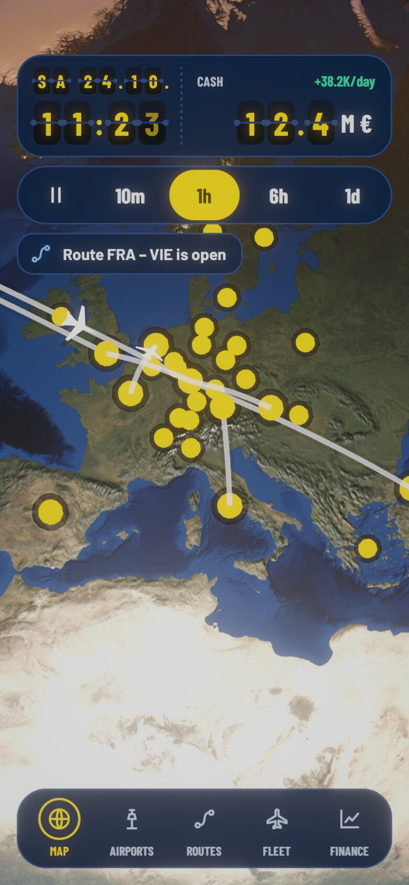
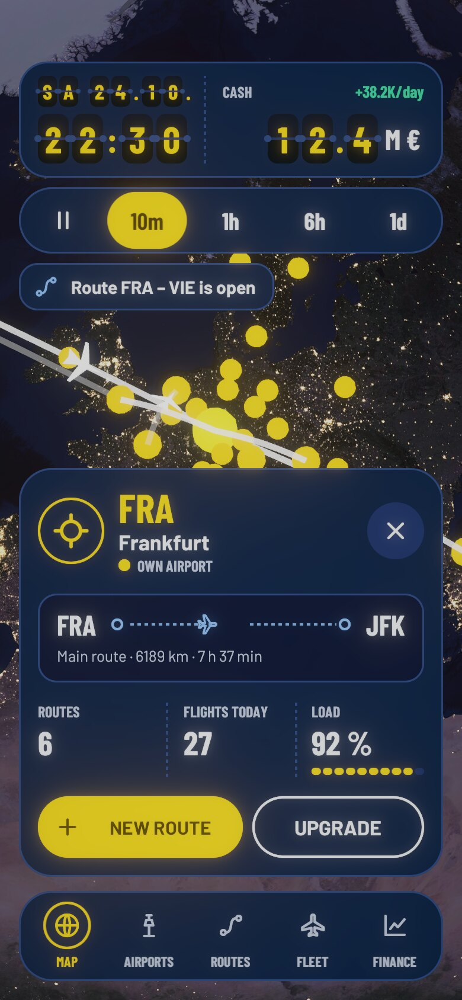

# HUD design "Gate Chart"

Status: 2026-10-25. Final concept for the airport tycoon HUD (phone, portrait, reference width 390). The tokens are machine-readable in `hud-tokens.json` (W3C format). The globe view stays untouched; the HUD sits on top as an overlay (see [SOLUTION.md](../SOLUTION.md), section 15).

## Implementation status (2026-10-25)

Implemented in Unity as the assembly `Tycoon.Hud` (`Assets/Hud`), wired into the demo (`Assets/Demo/DemoMain.cs`). The HUD shows date, time and cash as flip cards, the speed pill sets the game speed (pause, 10m, 1h, 6h, 1d), tapping an airport opens the selection sheet; the gate bar and the notices are in place. The demo's developer tools (quality, stress test, camera info) sit behind F1.

 

| File | Purpose |
|---|---|
| `HudTokens.cs` | the tokens as constants (a test checks them against `hud-tokens.json`) |
| `GateChartHud.cs` | builds and fills the screen, `Tick` per frame |
| `HudFlip.cs` | flip card (`FlipSlot`) and row (`FlipRow`) with the rule "changing faster than 3 times a second: dimmed, no flipping" |
| `HudSprites.cs`, `HudIcons.cs` | rounded surfaces and icons, drawn at run time from SVG paths, no image files |
| `HudFormat.cs` | date, clock, cash (three digits plus unit) |
| `IHudModel.cs` | what the HUD needs from the game: time, cash, set speed, airport texts, notices |

Not implemented or provisional:
- **Fonts:** Barlow and Barlow Condensed are included (`Assets/Hud/Resources/Fonts`), license and obligations in [FONTS.md](FONTS.md). A "Licenses" page inside the app is still missing.
- The gate bar only switches the highlight; airports, routes, fleet and finance have no screens yet. "New route" and "Upgrade" only show a notice.
- The selection ring (white with navy outline) is missing in the view: selected airports are just drawn larger there, and own airports are now yellow.
- The dashed line for planned routes is missing in the view.
- Cash, load factor and "flights today" are invented in the demo (`FakeController`).
- Not tested on a device.

## Where the parts come from

The concept is a mix of the variants from the selection process:

| Part | From | Content |
|---|---|---|
| Colour concept, dark blue ground | G Flight chart | navy for cards and panels, signal yellow as the only accent, map blue for lines |
| Route strip | G | `FRA ○ – – ✈ – – ○ MUC` with a small plane, distance and duration below |
| Gate bar at the bottom | G | five entries with icon and label, active = yellow ring and yellow text |
| Shared top pill | H Departure board | one card for time and cash |
| Flip cards for time and date | B Terminal signage | yellow digits on dark flip cards, date smaller above the time |
| Speed pill | E Gate pill | pill with pause, 10m, 1h, 6h, 1d; active = signal yellow |

Not taken over: daylight bar (D), compass ring and scale bar (G), waypoint bar for the speed (G).

## Screen layout (top to bottom)

1. **Top pill:** card (radius 24). On the left the date (small flip cards, `SA 24.10.`) above the time (`11:20`); on the right, separated by a dashed line, the cash (`12.4 M €`, flip cards the size of the time, unit 24 px) with the change per day. The speed is **not** here but in the speed pill.
2. **Speed pill:** directly below, 8 px gap. Pause, 10 min/s, 1 h/s, 6 h/s, 1 day/s (labels `10m`, `1h`, `6h`, `1d`). The yellow highlight is a slider knob: it glides to the chosen step in about 0.2 s, and the labels turn dark as it passes beneath them.
3. **Notice (optional):** below that, card radius 16, icon in the status colour (info, success, warning, error).
4. **Globe** in between (markers, routes and labels come from the view, or the HUD draws them at the anchors; text white with outline `color.surface.base`).
5. **Selection sheet** (when an airport is selected), above the bar, 12 px gap: badge with the airport sign, code in yellow, name, kind chip, close; route strip; three key figures with dashed separators; two pill buttons.
6. **Gate bar** at the bottom, 16 px margin.

Margins: 16 px at the sides, 52 px at the top (real status bar), 16 px at the bottom.

## Rules

- **Flip cards:** time and cash the same size 26 × 42, date 16 × 26. Change: the upper half folds down in 110 ms, then the lower half shows the new digit (110 ms), 40 ms stagger between digits. No flipping with `ReduceMotion`.
- **High speed:** a digit that would have to change more than 3 times a second does not flip but stands still, dimmed (at 10 min/s the minute units, at 1 h/s also the minute tens, at 6 h/s and 1 day/s also the hour units). This matches the view's calm rule (`CalmRange`).
- **Cash below zero:** digits and change in `color.status.negative`.
- **Locked** (`SetInputEnabled(false, …)`): speed pill half transparent, text `color.text.disabled`.
- **Touch targets** at least 48 px.
- **Panels** are opaque (no blur); that keeps them cheap on low-end devices and readable on bright surfaces.

## Colours and contrast (on `color.surface.panel`)

| Pair | Contrast |
|---|---|
| text.primary | 15.0 : 1 |
| text.secondary | 9.4 : 1 |
| accent.primary (yellow) | 11.1 : 1 |
| text.on-accent on yellow | 13.1 : 1 |
| yellow on flip card | 12.8 : 1 |
| status.positive / warning / negative | 9.1 / 9.0 / 5.8 : 1 |
| chart.line | 7.5 : 1 |
| text.disabled | 4.3 : 1 (locked elements only) |

## Connection to the globe view

- `color.map.own / competitor / available / closed` colour `AirportView.Color` per `AirportKind`; `color.map.route.active / planned / paused` colour `RouteView.Color` per `RouteStatus`. The controller reads them from the theme, the view stays colour-blind.
- Selection ring: `color.map.selection` with a navy outline.
- Open in the view: "planned" is shown there only through transparency (0.3); the concept's dashed line would be new.
- The selection sheet covers the lower part: `SetViewportInsets(0, sheetHeight, 0, 0)` keeps the selected airport visible. Set `SetPointerBlocker` for the UI area.

## Implementation notes

1. **Theme:** the tokens live in `HudTokens.cs`; a test compares them with `hud-tokens.json`.
2. **Fonts:** Barlow and Barlow Condensed (SIL OFL) are Unity fonts; if the HUD moves to TextMeshPro, create static font assets from them with the needed characters (digits, Latin, umlauts, −, –, ·).
3. **uGUI:** the HUD is built in code; rounded cards are 9-slice sprites made at run time, the dashed line is a tiled texture.
4. **Tests:** EditMode tests cover parsing the tokens, the flip-card logic (which digit changes when, as a pure function), the speed slider, the texts and the airport sheet.

## Open points

- Date with year? Today `SA 24.10.`; weekdays and format need localisation.
- Cash for other magnitudes: at most three digits plus a separator and a unit K, M or B (`845 K €`, `12.4 M €`, `1.2 B €`).
- Landscape and large system font sizes are not designed.
- Gate bar labels in longer languages (66 px per entry).
- Colour blindness: own airport (yellow) and competitor (pink) differ in colour and brightness; check with a simulator.
- The sample values in the design (6 routes, 38 flights, 82 %, 300 km, 55 min, 12.4 M €) are placeholders.
