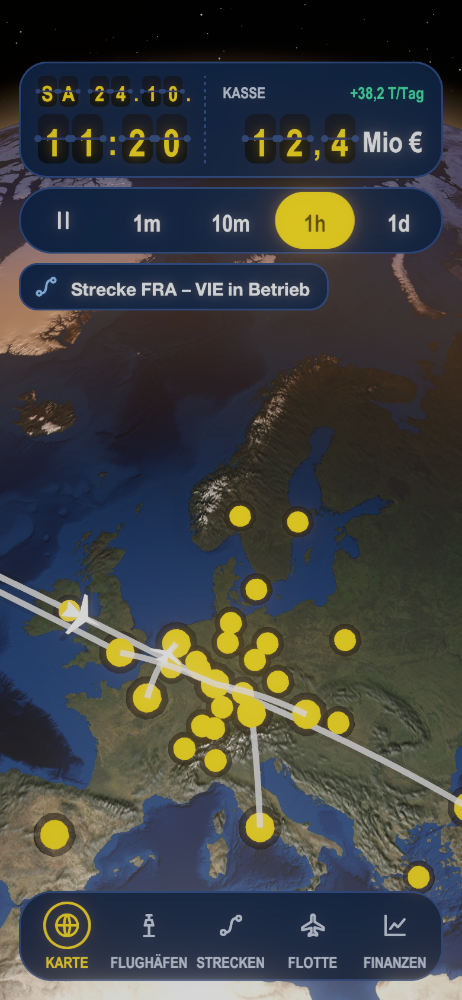
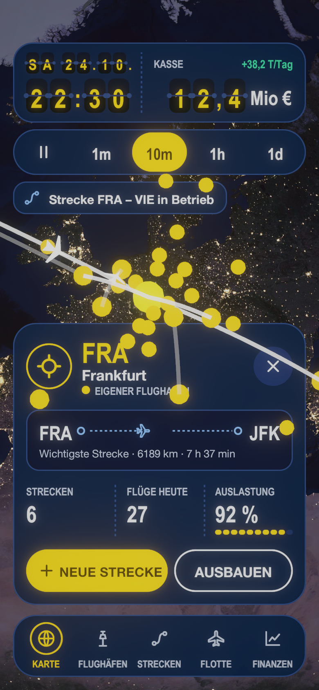

# HUD-Gestaltung „Gate Chart“

Stand: 2026-10-25. Finales Konzept für das HUD des Flughafen-Tycoon (Handy, Hochformat, Referenzbreite 390). Die Tokens stehen maschinenlesbar in `hud-tokens.json` (W3C-Format), die Bilder in einem privaten Canvas: <https://claude.ai/artifact/TuKtDTBCXY4mwNHoNCSYPf> (Boards I und J). Die Globus-View bleibt unberührt; das HUD liegt als Overlay darüber (siehe `docs/LOESUNG.md`, Abschnitt 15).

## Stand der Umsetzung (2026-10-25)

Umgesetzt in Unity als Assembly `Tycoon.Hud` (`Assets/Hud`), eingebunden in die Demo (`Assets/Demo/DemoMain.cs`). Das HUD zeigt Datum, Zeit und Kasse als Klappkarten, die Tempo-Pille setzt die Spielgeschwindigkeit (Pause, 10m, 1h, 6h, 1d), ein Tipp auf einen Flughafen öffnet das Auswahl-Fenster, die Gate-Leiste und die Hinweise stehen. Die Entwickler-Werkzeuge der Demo (Qualität, Stresstest, Kamera-Info) liegen hinter F1.

 

| Datei | Aufgabe |
|---|---|
| `HudTokens.cs` | die Tokens als Konstanten (ein Test prüft sie gegen `hud-tokens.json`) |
| `GateChartHud.cs` | baut und füllt den Bildschirm, `Tick` pro Frame |
| `HudFlip.cs` | Klappkarte (`FlipSlot`) und Zeile (`FlipRow`) mit der Regel „schneller als 3 Wechsel pro Sekunde: gedimmt, ohne Klappen“ |
| `HudSprites.cs`, `HudIcons.cs` | abgerundete Flächen und Symbole, zur Laufzeit aus SVG-Pfaden gezeichnet, keine Bilddateien |
| `HudFormat.cs` | Datum, Uhr, Kasse (drei Ziffern plus Einheit) |
| `IHudModel.cs` | was das HUD vom Spiel braucht: Zeit, Kasse, Tempo setzen, Flughafen-Texte, Hinweise |

Nicht umgesetzt oder vorläufig:
- **Schriften:** Barlow und Barlow Condensed sind eingebunden (`Assets/Hud/Resources/Fonts`), Lizenz und Pflichten in `SCHRIFTEN.md`. Eine Seite „Lizenzen“ in der App fehlt noch.
- Die Gate-Leiste wechselt nur die Markierung; Flughäfen, Strecken, Flotte und Finanzen haben noch keine Bildschirme. „Neue Strecke“ und „Ausbauen“ zeigen nur einen Hinweis.
- Der Auswahlring (weiß mit Marine-Kontur) fehlt in der View: gewählte Flughäfen werden dort weiter nur größer gezeichnet, und Eigene sind jetzt gelb.
- Die gestrichelte Linie für geplante Strecken fehlt in der View.
- Kasse, Auslastung und „Flüge heute“ sind in der Demo erfunden (`FakeController`).
- Nicht auf einem Gerät geprüft.

## Herkunft der Bausteine

Das Konzept ist eine Mischung aus den Varianten des Auswahlprozesses:

| Baustein | aus | Inhalt |
|---|---|---|
| Farbkonzept, dunkelblauer Grund | G Flugkarte | Marineblau für Karten und Panels, Signalgelb als einziger Akzent, Kartenblau für Linien |
| Strecken-Streifen | G | `FRA ○ – – ✈ – – ○ MUC` mit kleinem Flugzeug, darunter Entfernung und Dauer |
| Gate-Leiste unten | G | Fünf Einträge mit Symbol und Beschriftung, aktiv = gelber Ring und gelber Text |
| Gemeinsame obere Pille | H Abflugtafel | Eine Karte für Zeit und Kasse |
| Klappkarten für Zeit und Datum | B Terminal Signage | Gelbe Ziffern auf dunklen Klappkarten, Datum kleiner über der Zeit |
| Tempo-Pille | E Gate Pill | Pille mit Pause, 10m, 1h, 6h, 1d; aktiv Signalgelb |

Nicht übernommen: Tageslichtleiste (D), Kompass-Ring und Maßstabsleiste (G), Wegpunkt-Leiste für das Tempo (G).

## Aufbau des Bildschirms (von oben nach unten)

1. **Obere Pille:** Karte (radius 24). Links Datum (kleine Klappkarten, `SA 24.10.`) über der Zeit (`11:20`), rechts durch eine gestrichelte Linie getrennt die Kasse (`12,4 Mio €`, Klappkarten in Größe der Zeit, Einheit 24 px) mit der Änderung pro Tag. Das Tempo steht **nicht** hier, sondern in der Tempo-Pille.
2. **Tempo-Pille:** direkt darunter, Abstand 8 px. Pause, 10 min/s, 1 h/s, 6 h/s, 1 Tag/s (Beschriftung `10m`, `1h`, `6h`, `1d`). Die gelbe Markierung ist ein Schieberegler-Knopf: Sie gleitet in etwa 0,2 s zur gewählten Stufe, und die Beschriftungen färben sich dunkel, während sie darunter vorbeizieht.
3. **Hinweis (optional):** darunter, Karte radius 16, Symbol in Statusfarbe (Info, Erfolg, Warnung, Fehler).
4. **Globus** dazwischen (Marker, Routen, Beschriftungen kommen aus der View bzw. werden vom HUD an den Ankern gezeichnet, Text weiß mit Rand `color.surface.base`).
5. **Auswahl-Fenster** (bei gewähltem Flughafen), über der Leiste, Abstand 12 px: Abzeichen mit Flughafen-Zeichen, Code in Gelb, Name, Art-Chip, Schließen; Strecken-Streifen; drei Kennzahlen mit gestrichelten Trennern; zwei Pillen-Buttons.
6. **Gate-Leiste** unten, 16 px Rand.

Ränder: 16 px seitlich, 52 px oben (echte Statusleiste), 16 px unten.

## Regeln

- **Klappkarten:** Zeit und Kasse gleich groß 26 × 42, Datum 16 × 26. Wechsel: Oberhälfte klappt in 110 ms herunter, danach zeigt die Unterhälfte die neue Ziffer (110 ms), 40 ms Versatz zwischen Ziffern. Bei `ReduceMotion` kein Klappen.
- **Hohes Tempo:** Eine Ziffer, die öfter als 3 × pro Sekunde wechseln müsste, klappt nicht, sondern steht gedimmt still (bei 10 min/s die Minuten-Einer, bei 1 h/s auch die Minuten-Zehner, bei 6 h/s und 1 Tag/s auch die Stunden-Einer). Das passt zur Calm-Regel der View (`CalmRange`).
- **Kasse im Minus:** Ziffern und Änderung in `color.status.negative`.
- **Gesperrt** (`SetInputEnabled(false, …)`): Tempo-Pille halb transparent, Text `color.text.disabled`.
- **Tastflächen** mindestens 48 px.
- **Panels** sind deckend (kein Blur), das hält sie auf Low-End-Geräten billig und auf hellen Flächen lesbar.

## Farben und Kontrast (auf `color.surface.panel`)

| Paar | Kontrast |
|---|---|
| text.primary | 15,0 : 1 |
| text.secondary | 9,4 : 1 |
| accent.primary (Gelb) | 11,1 : 1 |
| text.on-accent auf Gelb | 13,1 : 1 |
| Gelb auf Klappkarte | 12,8 : 1 |
| status.positive / warning / negative | 9,1 / 9,0 / 5,8 : 1 |
| chart.line | 7,5 : 1 |
| text.disabled | 4,3 : 1 (nur für gesperrte Elemente) |

## Anbindung an die Globus-View

- `color.map.own / competitor / available / closed` färben `AirportView.Color` je `AirportKind`; `color.map.route.active / planned / paused` färben `RouteView.Color` je `RouteStatus`. Der Controller liest sie aus dem Theme, die View bleibt farbenblind.
- Auswahlring: `color.map.selection` mit Marine-Kontur.
- Offen in der View: „geplant“ wird dort heute nur über Transparenz (0,3) dargestellt; die gestrichelte Linie des Konzepts wäre neu.
- Das Auswahl-Fenster verdeckt den unteren Teil: `SetViewportInsets(0, Fensterhöhe, 0, 0)` hält den gewählten Flughafen sichtbar. Für die UI-Fläche `SetPointerBlocker` setzen.

## Umsetzung in Unity (Vorschlag)

1. **Theme:** `HudTheme` (ScriptableObject) mit Farben, Abständen, Radien, Zeiten; ein Editor-Import liest `hud-tokens.json`.
2. **Schriften:** Barlow und Barlow Condensed (SIL OFL) sind als Unity-Schriften eingebunden; sollte das HUD auf TextMeshPro wechseln, daraus statische Fontassets mit den benötigten Zeichen (Ziffern, lateinisch, Umlaute, − , –, ·) erzeugen.
3. **Bauteile als Prefabs:** `FlipDigit` (zwei Bildhälften mit Maske, Klappanimation), `TopPill`, `SpeedPill`, `Toast`, `AirportSheet`, `GateDock`, `RouteStrip`, `Chip`, `PillButton`.
4. **uGUI oder UI Toolkit:** noch offen (Migrationsplan, Abschnitt 8). Die Tokens sind für beides geeignet; USS-Variablen lassen sich aus dem JSON erzeugen. Abgerundete Karten gehen in uGUI am einfachsten mit 9-Slice-Sprites, die gestrichelte Linie mit einer gekachelten Textur.
5. **Tests:** EditMode-Tests für das Parsen der Tokens, Mindest-Kontrast und Mindest-Tastfläche; die Klappkarten-Logik (welche Ziffer wann wechselt) als reine Funktion testen.

## Offene Punkte

- Datum mit Jahr? Heute `SA 24.10.`; Wochentage und Format müssen lokalisiert werden.
- Kasse für andere Größenordnungen: Vorschlag höchstens drei Ziffern plus Komma, Einheit T, Mio oder Mrd (`845 T €`, `12,4 Mio €`, `1,2 Mrd €`).
- Querformat und große Schriftgrößen (Systemeinstellung) sind nicht entworfen.
- Beschriftung der Gate-Leiste in längeren Sprachen (Platz je Eintrag 66 px).
- Farbenblindheit: Eigener Flughafen (Gelb) und Konkurrent (Rosa) unterscheiden sich in Farbe und Helligkeit; mit einem Simulator prüfen.
- Die Beispielwerte im Canvas (6 Strecken, 38 Flüge, 82 %, 300 km, 55 min, 12,4 Mio €) sind Platzhalter.
